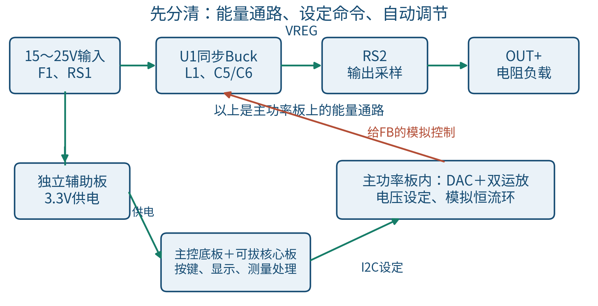
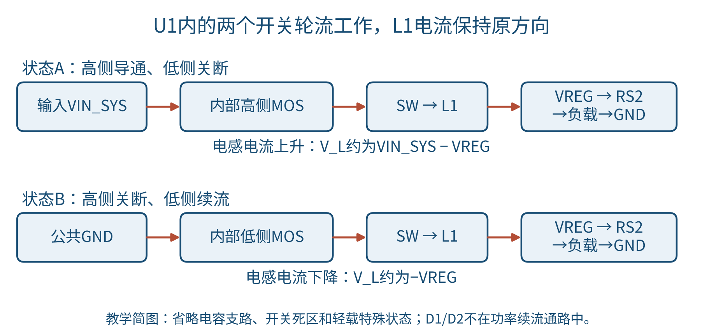
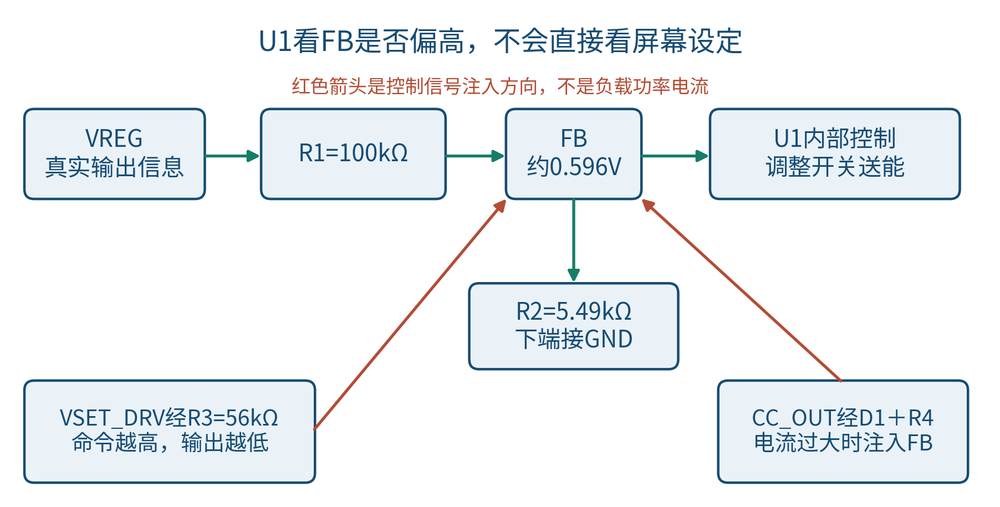
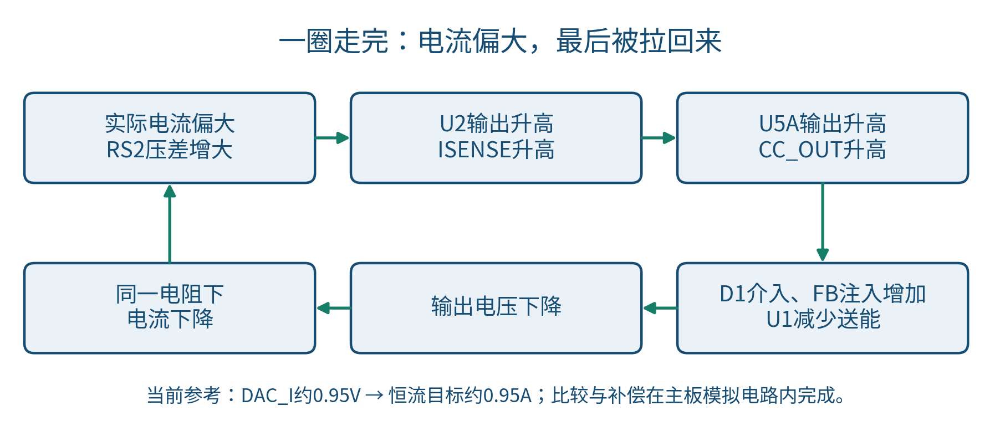
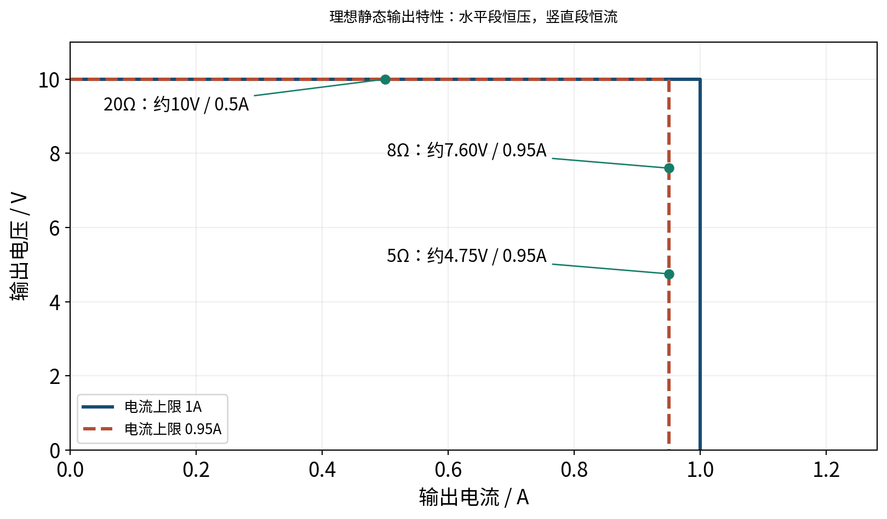

# G题主功率电路：从零理解恒压与恒流

从电流怎么流，到恒压恒流怎么自动切换。

阅读对象：刚接触开关电源、希望能看懂自己原理图并讲出设计原理的同学。

版本：2026-11-09，依据3c3574c/R7工程的主功率板。本文是讲解资料，不修改电路。图中的开关、框图和曲线都是教学示意，不是完整接线图，也不是实测波形。

## 1. 先记住整机里谁负责什么

这台装置要从15～25V直流输入，得到可设定的较低电压。负载正常时保持电压；负载太重、电流要超过设定值时，主动降低电压，让电流保持在设定值附近。

可以把它理解成三个人配合：STM32负责告诉电路“想要多少伏、最多多少安”，TPS54302负责高速搬运能量，模拟恒流环负责发现电流太大并压低输出。屏幕只把测量值和设定值显示出来。

当前主功率板把功率变换、采样、DAC和模拟恒流环放在同一块板上。这样，大电流回路短，敏感的反馈FB也不用经过板间排线；主控板只传数字通信、使能和采样信号。

|部分|主要器件|直接做什么|
|---|---|---|
|功率变换|U1 TPS54302、L1、C1～C6|把输入电能变成较低电压的输出|
|设定|U4 MCP4728、U5的B单元|把数字设定变成真实模拟电压|
|电流限制|RS2、U2 INA180A1、U5的A单元、D1等|电流偏大时要求Buck降压|
|测量与显示|U3 INA226、R7/R8、STM32、屏幕|知道输入输出实际是多少|
|辅助供电|独立3.3V辅助板|给控制、采样、DAC和屏幕供电|

这里有两个“主控”：STM32是整机管理者；U1是功率开关的控制者。STM32并没有直接输出PWM去驱动本方案的功率MOS管。

## 2. 先沿粗导线走一遍

主电流通路是：输入正柱J1P → 保险丝F1 → 输入采样电阻RS1 → VIN_SYS → U1内部高侧开关 → SW → 电感L1 → VREG → 输出采样电阻RS2 → OUT+ → 负载 → GND → 输入负柱J1N。

这个箭头描述高侧开关导通时的主要通路。开关关断时，电感电流走内部低侧开关形成的续流通路，后面会分开讲。电容也在交换瞬时电流，不能把整台开关电源理解成始终只有一条不变的串联电流。

先分清四个名字：RAW+是刚进入板子的输入正极；VIN_SYS是经过保险丝和输入采样电阻之后的输入；VREG是电感后、输出采样电阻前的内部输出；OUT+才是接负载的正端。

|网络|你应该在图上找哪里|大致电压|
|---|---|---|
|RAW+|输入正极接线柱|15～25V输入|
|VIN_SYS|F1、RS1之后，U1的VIN端|略低于RAW+|
|SW|U1与L1之间|快速高低切换，不是平稳直流|
|VREG|L1之后、RS2之前|内部受控输出电压|
|OUT+|RS2之后，输出正极接线柱|负载实际得到的电压|
|+3V3|辅助板输出的控制电源|约3.3V，不是功率输出|
|GND|输入负、输出负、控制地的公共参考|本系统的0V参考|

主功率板、主控板和辅助板共地，没有隔离变压器。每只四脚板凳柱的四个脚都是同一个电极，不是四路接口。

## 3. Buck到底怎样把25V变成10V

先假想一个很快的开关：一会儿接25V，一会儿接近0V。如果只看SW节点，它是一串脉冲，不能直接接给需要平稳电源的负载。电感和电容的作用，就是把这种断续的能量输送变得平滑。

### 3.1 高侧导通：输入给电感和负载送能量

U1内部高侧MOS管导通，低侧关断，SW接近VIN_SYS。电流从输入经过高侧MOS、L1流向输出。电感两端电压大约为VIN_SYS减VREG，所以电感电流逐渐上升。

电感的基本关系是 V_L = L × dI_L/dt。它的意思是：给电感加电压，会改变电流的上升或下降速度，而不是让电流一下跳变。L1=22μH就是用来限制每个开关周期内电流变化速度的。

### 3.2 高侧关断：电感继续给负载供电

高侧关断后，电感不愿让电流突然消失，SW被拉向低电位；正常续流时内部低侧MOS承担电流通路。电流沿GND → 低侧MOS → SW → L1 → 输出 → 负载 → GND流动，方向仍是从电感流向负载，只是电感电流在下降。

低侧与高侧交接的死区等细节中会涉及体二极管；轻载脉冲跳跃、断续电流等状态也与这张简图不同。这里先理解持续正向电流时的基本工作原理。

TPS54302内部已经集成高侧、低侧MOS管及驱动。**D1、D2是控制信号用的肖特基二极管，不是功率续流二极管。**这也是本方案能减少外部器件的原因之一。

### 3.3 导通比例决定平均输出

占空比D，是“每周期高侧开通的时间”除以“整个周期时间”。在理想、连续电流、稳态条件下，VREG约等于D × VIN_SYS。

所以，从25V得到约10V，D约为0.40；从15V得到约10V，D约为0.67。输入电压升高时，芯片会缩短开通比例，才能继续得到相同输出。

这不是说我们手动把PWM锁死在40%。实际U1根据反馈自动改变开关行为；器件压降、负载、轻载模式都会使真实情况偏离这个简单比例。

### 3.4 电容与电感各管什么

C1=100μF、C2=10μF、C3=100nF在输入端并联。它们共同为开关动作提供附近的电流来源，减少长导线供电造成的电压扰动；实际分工取决于ESR、ESL、频率和布局，不能只看容量大小。

C5、C6各22μF，接在VREG与GND之间。电感电流大于负载需求时给它们充电，小于负载需求时由它们补充电流，因此输出更平滑。44μF只是标称总量，陶瓷电容在直流偏压下可能变小。

C4=100nF接BOOT与SW，为内部高侧驱动提供自举电源。它不是普通的对地滤波电容，不能把SW那一端随意改接GND。

以25V输入、VREG约10V、约400kHz开关频率、L1=22μH作理想连续电流估算，电感电流峰峰纹波约0.682A。20Ω负载约0.5A时，电感峰值约0.841A。这是帮助理解量级的算术，不是实测或最坏上限；不能据此取消L1的Isat≥5A选型要求。

## 4. 芯片怎样知道输出高了还是低了

U1的FB是反馈输入。芯片会尝试让FB保持在内部参考附近，计算中暂按0.596V。FB高于目标，芯片倾向于减少送往输出的能量；FB低于目标，就倾向于增加能量。

可以先理解最普通的两电阻分压：上面的电阻从输出接到FB，下面的电阻从FB接地。输出越高，分压后的FB也越高，于是芯片知道“够了”。这就是负反馈：输出升高会触发压低输出的动作。

本设计在这个基础上加了两条“小电流注入”通路：R3负责调电压，D1加R4负责限电流。它们不是直接承受负载电流，而是在FB这个“判断点”上改变芯片看到的信号。

|元件|连接|作用|
|---|---|---|
|R1=100kΩ|VREG到FB|把内部输出信息送到反馈点|
|R2=5.49kΩ|FB到GND|和R1等一起确定反馈关系|
|R3=56kΩ|VSET_DRV到FB|引入可设置的电压命令|
|D1、R4=10kΩ|CC_OUT经D1、R4到FB|电流过大时增加反馈注入，要求降压|

FB是灵敏的模拟节点，因此它和R1～R4、D1留在主功率板上，不穿过10芯排线。把它拉很长、贴着SW走线，容易把开关噪声当成“输出变化”。

## 5. 为什么设定电压升高，功率输出反而降低

这里的“设定电压”指芯片之间传递的VSET_DRV，不是屏幕上的目标输出值。VSET_DRV升高，经R3流向FB的小电流增多，U1会以为输出偏高，于是降低真正的输出。屏幕上按“输出增加”时，软件应计算更低的DAC电压；这个反向关系由软件处理。

在D1截止、FB约等于参考值、忽略输入偏置电流时，对FB列电流关系可以得到：

VREG ≈ VFB × (1 + R1/R2 + R1/R3) − (R1/R3) × VSET_DRV

代入本图电阻与VFB≈0.596V：

VREG ≈ 12.516 − 1.786 × VSET_DRV

这个式子最值得记住的是负号。VSET_DRV每增加约1V，VREG大约下降1.786V。

|目标VREG，暂忽略RS2压降|VSET_DRV计算值|DAC A起始码，约1mV/码|
|---|---|---|
|10V|约1.409V|约1409|
|8V|约2.529V|约2529|
|7V|约3.089V|约3089|

U4的A通道采用内部2.048V参考、增益2的配置，理想码值换算为V_DAC_A≈code × 4.096/4096 V，即约1mV/码。但U4只有3.3V供电，4.096V只是换算尺度，不能真的输出到4.096V。7V设定要求模拟电压接近3.089V，已比较靠近3.3V电源上端，需要实际检查DAC与运放是否还能线性输出。

这解释了为什么“7V是软件设定”也会涉及硬件：软件可以给出数字码，硬件必须有能力输出对应电压。本版本没有通过文档计算就证明7V端点已验收。

### 5.1 为什么电压命令还要经过U5B

U4.6输出DAC_V，经R10=1kΩ、C12=100nF形成低通，再送到U5.5。U5B的输出U5.7直接接回反相输入U5.6，构成电压跟随器，输出名为VSET_DRV。

跟随器相当于“照着输入电压输出，但替前级承担一定的负载电流”。R10/C12减轻设定变化和噪声，U5B把这个设定送给R3；它没有放大成高电压，也不能突破自己的3.3V供电范围。

### 5.2 为什么VREG与万用表读数有一点差别

RS2=0.05Ω在VREG与OUT+之间。负载电流流过它时，产生I_OUT × 0.05Ω的压降，所以：

VOUT = VREG − 0.05 × I_OUT

0.5A时差25mV，0.95A时差47.5mV。R1反馈取VREG，而显示的电压分压取OUT+，因此同样设定下，负载端电压会比内部稳压点略低。这个小误差应在系统校准和指标核对中考虑。

例如，要在0.5A时把负载端校准到10.000V，VREG需约10.025V，对应VSET_DRV约1.395V。这只是说明校准方法，不是本轮改了固件起始码。

## 6. 电流怎样变成一个能比较的电压

RS2是一个很小的电阻：0.05Ω。它不是用来故意消耗大量功率，而是让电流留下可测量的“小压差”。流过1A时，两端相差0.05V，也就是50mV。

U2 INA180必须是A1版本，电压增益20倍。它测RS2两端的压差，并输出相对GND的ISENSE信号：

V_ISENSE ≈ 20 × 0.05 × I_OUT = 1 × I_OUT

意思是：1A对应约1V，0.95A对应约0.95V，0.5A对应约0.5V。这个数值关系使恒流参考和STM32采样都比较直观。

U2.3接VREG，U2.4接OUT+，U2.1输出ISENSE。两个输入都可能在接近10V的位置，而运放输出是约0～1V的对地信号；选用能处理这种共模电压的专用电流检测芯片，就是为了避免普通运放直接测高侧小压差的困难。

采样电阻功耗是I²R。1A时RS2消耗0.05W。BOM选择1W额定不是说它一直消耗1W，而是给封装、温升和瞬态等留余量；精度还受电阻误差、温漂、放大器失调和走线影响。

所谓Kelvin采样，是从电阻两端的焊盘附近另引两条细信号线去U2，避免把大电流铜线上的额外压降也当成电阻压降。它不表示BOM里的RS2一定是四端封装。

## 7. 恒流环怎么让输出电流稳定

电流采样先经R11=1kΩ、C13=10nF成为I_FILT，再进入U5A同相输入U5.3。电流目标由U4的B通道DAC_I给出，经R12=100kΩ到U5.2的I_ERR节点。U5A输出U5.1叫CC_OUT。

请先按下图读方向，不急着看所有电阻电容：

实际电流偏大 → ISENSE升高 → U5A让CC_OUT升高 → D1导通、经R4向FB注入更多电流 → U1减小能量输送 → 输出电压下降 → 同一电阻负载下电流下降。

这条链最终让最初的“电流偏大”变小，所以也是负反馈。没有哪一步需要人手动把模式从恒压拨到恒流。

若工作在线性恒流稳态、D2截止且积分反馈有效，电容不传直流，U5A会使I_FILT与DAC_I接近相等。于是：

I_SET ≈ V_DAC_I / (20 × RS2) ≈ V_DAC_I / 1Ω

U4的B通道配置内部2.048V参考、增益1，理想每码约0.5mV；1900码对应约0.95V，即约0.95A。这是当前参考起始值，实际还要校准。它位于题目1A±0.1A的稳态范围内，但不代表任意瞬间都不会超1A。

### 7.1 D1为什么不可省

电流不够大时，CC_OUT较低，D1截止，恒流环基本退出，电压环正常调压。电流太大时，CC_OUT高到足以推动D1导通，才开始接管、压低输出。

D1方向是阳极接CC_OUT、阴极接CC_K，CC_K再经R4接FB。方向画反，控制作用就变了。BAT54这里用的是单二极管，不能把BAT54A、BAT54C、BAT54S这些内部连接不同的型号直接替代。

### 7.2 C14、R13是为了让它调得稳

反馈支路是CC_OUT → R13=1kΩ → COMP → C14=220nF → I_ERR。C14提供积分作用：只要电流还偏离目标，控制输出就继续朝纠偏方向调整，减少稳态误差。R13提供比例/高频反馈成分；整条支路的作用要和主Buck动态、滤波及负载一起分析。

R12 × C14的标称乘积是22ms。它是积分网络的参数量级，**不是“整机一定22ms恢复”**，也不是输出电流延迟22ms才被检测。

如果C14有效容量变成160nF，乘积为16ms；变成120nF，为12ms。积分作用更强，不能简单认定一定更好。X7R应结合具体料号、偏压、温度和初始容差评估；C14在控制电路里，不直接承受5～10V的功率输出电压。

### 7.3 D2为什么还要再放一只

D2阳极接I_ERR、阴极接CC_OUT。在恒压状态、运放趋向低输出时，它提供非线性钳位通路，减轻积分电容长时间积累过大的误差，也就是常说的抗积分饱和，让重新进入恒流时少一些不必要的恢复过程。

D2不能消除所有过冲，也不能把输出电容里已经储存的能量瞬间清空。D1负责让恒流控制按需要介入，D2主要照顾控制器自身的恢复，这两只二极管作用不同。

## 8. 用20Ω、8Ω、5Ω三个负载把模式切换讲清楚

先做最简单的理想演示：电压设10V，电流上限设1A。20Ω只需要0.5A，没超上限，所以保持10V；8Ω若还给10V就需要1.25A，超过上限，电路会把电压降到约8V，此时8V/8Ω=1A；换5Ω后降到约5V，仍为1A。

|负载|如果硬要10V会流多少电流|理想1A上限的最终状态|当前0.95A参考目标的约略状态|
|---|---|---|---|
|20Ω|0.5A|恒压，约10V/0.5A|恒压，约10V/0.5A|
|8Ω|1.25A|恒流，约8V/1A|恒流，约7.60V/0.95A|
|5Ω|2A|恒流，约5V/1A|恒流，约4.75V/0.95A|

对纯电阻负载、忽略压降及误差，可以记成I_OUT约等于min(V_SET/R_LOAD，I_SET)。相应VOUT约等于min(V_SET，I_SET×R_LOAD)。电路会自动选择能同时满足两个限制的工作点。

恒流不是给任何负载都强行灌满1A。例如20Ω想流1A就要20V，但你把电压上限设成10V，电路就只给约0.5A。恒流成立还要有足够的输入电压、允许的输出范围和可用控制余量；不能凭这个公式保证硬短路或任意负载下仍按设定稳定工作。

## 9. 为什么恒流了，示波器仍可能看到超1A尖峰

关键是C5/C6在VREG上储存了电荷。负载突然变小的那一刻，电容电压不能瞬间跳低；在控制环把电压降下来之前，电容会先向新的负载放电。

忽略ESR、ESL和其他瞬态因素，初始电流可粗略按I(0+)≈VREG(0−)/(R_NEW+RS2)估计。这个式子保留RS2，是因为本图电容在RS2前面。不能把其他电容位置不同的电路公式不加区分地套过来。

|初始工作点与切换|简化估算首峰|解释|
|---|---|---|
|VREG约10V，20Ω切8Ω|10/(8+0.05)≈1.242A|约1.24A不是补偿电容造成的全部问题|
|8Ω、0.95A稳定后切5Ω|[0.95×(8+0.05)]/(5+0.05)≈1.514A|对应当前0.95A参考目标|
|8Ω、1A稳定后切5Ω|[1×(8+0.05)]/(5+0.05)≈1.594A|把目标改成1A时不能继续沿用1.51A数字|

这些是明确初始条件下的示意算术，不是实测峰值或最坏上限。实际连线、开关过程和器件寄生会改变波形。

U2能检测到流经RS2的电容放电电流，但检测、滤波和控制都需要时间。缩小C14可能改变后续恢复，却不能撤销已经发生的放电脉冲。如果题目“最大不超过1A”按瞬时严格上限验收，当前结构尚没有完成这个保证，需要另行设计并验证输出侧限流等措施；本文不把稳态达标说成瞬时达标。

## 10. 四个测量值分别从哪里来

|显示量|实际测量来源|怎样换算|
|---|---|---|
|输入电压Ui|U3 INA226的VBUS端接RAW+|按INA226寄存器比例读取|
|输入电流Ii|RS1=0.05Ω，U3测它两端差分电压|按采样电阻和INA226校准配置换算|
|输出电压Uo|OUT+经R7=100kΩ、R8=10kΩ分压，送STM32 PA2|Uo≈11×V_ADC|
|输出电流Io|U2输出ISENSE送STM32 PA1|Io≈V_ISENSE/1Ω|

输入侧U3与输出侧U2是两种不同的测量方式：INA226通过I2C读数字寄存器，INA180输出模拟电压给ADC及恒流环。把输入电流和输出电流当成相等，会算错效率。

R7/R8把10V缩为约0.909V，使其进入3.3V ADC可测范围；C7=10nF做滤波。ADC读数还要乘实际参考电压并校准，不是读到一个整数就直接当作伏数。

辅助板从VIN_SYS取电，处在RS1之后。因此正常唯一输入供电时，RS1测到的电流包含主功率和辅助电源消耗。评估整机效率时不能漏掉控制与显示功耗，也不能外接USB给控制板供电后仍声称测到的是同样的整机效率。

转换效率η=Uo×Io/(Ui×Ii)。以25V输入、8Ω且1A为理想示例，输出8W，若效率恰为85%，输入约9.41W、电流约0.376A。这个例子说明降压时输入电流通常不等于输出电流，不是本机效率实测。

## 11. 输入保护、开关使能与板间接口

F1是输入2A保险丝，保护的是输入侧严重过流的一部分情况。它有动作时间，也看输入电流，既不精确设定输出1A，也不替代CC环。U1的3A级能力或内部保护同样不等于输出会自动限定为1A。

RUN从STM32 PA8经R5=1kΩ到U1 EN，R6=100kΩ把EN拉向GND。主控未就绪时，硬件下拉帮助保持关断；推荐先保持RUN低，确认3.3V正常、DAC配置写入并核对、等待模拟设定稳定，再允许启动。电阻不能保证所有错误固件、接线故障或电源异常都安全。

RUN拉低是停止芯片主动开关，不是机械断开输出。输出电容上的电压仍需经负载等通路消退，也不表示能够阻断外部电源向板内倒灌。

|主功率板J3脚号|网络|用途|
|---|---|---|
|1|+3V3|控制电源|
|2、10|GND|公共参考|
|3、4|SCL、SDA|I2C连接INA226和MCP4728|
|5、6|VSET_DRV、CC_OUT|模拟节点测试观察，不接STM32输出驱动|
|7、8|ISENSE、VOUT_ADC|给STM32的电流、电压模拟采样|
|9|RUN|功率开关允许信号|

I2C上拉在主控底板R14/R15，各4.7kΩ。本图U4的LDAC接GND，RDY经R9上拉；RDY不是主功率的使能脚。固件应明确写入并核对DAC参考、增益和数据，不能只发一个码值就默认所有配置正确。

## 12. 为什么采用这种设计，哪里又没有那么简单

器件数量少，主要来自三个选择：用内置功率MOS和驱动的同步Buck，不单独设计功率PWM驱动；用一只双运放同时完成设定缓冲与恒流控制；用DAC提供设定，让按键和显示留给可拔插STM32模块。

代价是设计者必须弄清反馈注入的正负方向、运放高端余量和两条闭环的动态配合。电路图元件少，不代表环路不需要调试。芯片的典型指标、基础库身份和静态连线通过，也都不能替代样机测量。

画PCB时，先缩短输入电容、U1和地构成的高频电流环路；SW铜区控制范围，远离FB和采样；C4紧贴BOOT/SW；RS1/RS2采用Kelvin采样；控制电源去耦靠近各芯片。原理图的六个方框只是功能分区，不是要求PCB照着摆成六个矩形。

目前仍需实际核查：C5/C6和C14有效容值、U1开关与环路稳定性、7V设定的DAC/运放高端范围、0.95A校准及负载切换峰值、整机效率、输入25V时的瞬态与温升、辅助3.3V和屏幕电压容差、核心板外供3.3V的反灌情况。不要把这份说明当成“已经全部满足题目”的验收报告。

本题是模拟充电装置，主要用功率电阻负载验证。这套说明不构成真实电池充电器设计；当前电路没有因此获得电池所需的反接、倒灌、充电终止或温度管理等能力。

## 13. 初次上电，先看什么，后看什么

1. 断电核对输入输出极性、各四脚柱同网、芯片脚序、采样电阻和3.3V无明显短路。核心板首针版本必须与R7一致；不要接真实电池。
2. 分别确认辅助供电与控制部分，主功率保持RUN低。检查3.3V，核对DAC_V、VSET_DRV和DAC_I是否随命令变化；特别关注7V端点所需的约3.089V能否达到。
3. 使用带限流功能的台式电源，从15V输入开始，准备满足功率和散热的电阻负载。限流值应兼顾预计功率和启动过程，不能给出一个不分条件的固定值。
4. 先验证恒压与采样：空载和20Ω约10V，万用表测OUT+对GND，并与屏幕对比；同时知道VREG会比OUT+略高。
5. 再按题目条件验证25V输入、20Ω→8Ω→5Ω的自动切换，先确认稳态，再观察瞬态。8Ω、5Ω电阻需按I²R核对实际发热和额定功率。
6. 测输出纹波和负载阶跃电流，检查有无振荡、明显过冲及恢复问题；最后在热稳定条件下核查效率和温升。

测普通对地信号时，示波器地夹接系统GND；**不要把地夹接SW、BOOT或RS2某个高侧端点**。高侧差分测量使用合适的差分探头。测C14两端电压，可用合适差分方式，或两通道对GND后做数学相减，并注意共模与误差。若要判断瞬时电流峰值，不能把经过滤波或带宽有限的ISENSE波形当作无误差的真实峰值。

题目测试说明规定输入值读台式电源、输出值读外接数字万用表，未单列提交示波器波形。但调试仍建议测波形；“最大不超过1A”的瞬时验收口径不能靠猜测放宽。

## 14. 你可以怎样向别人讲这块板

可以按下面这段话复述，然后再用图上的器件补充细节：

“我们用TPS54302同步Buck把15～25V降到需要的输出。它内部有功率开关，外部用22μH电感和输出电容平滑能量。STM32通过DAC设置电压命令和电流目标，本身不直接产生主功率PWM。输出电流由0.05Ω电阻和20倍电流检测放大器转成每安约1伏的信号。负载轻时，恒流支路退出，由Buck维持电压；负载重时，运放经二极管给FB注入电流，让Buck自动降压，达到恒流。输入输出采样交给主控显示。稳态恒流不等于瞬时硬限流，输出电容放电尖峰还需要实测。”

最后用五个问题自查：D1为什么不是续流二极管？VSET_DRV为什么越高输出越低？电流太大时CC_OUT应升还是降？为什么VREG比OUT+高？为什么RUN关断后输出可能还有电？如果能用自己的话回答，就已经抓住主功率电路的主线。

## 15. 逐区查阅表与资料依据

|主板功能区|主要器件|读图时先追哪条线|
|---|---|---|
|1 输入保护、输入采样与接口|J1P/N、F1、RS1、U3、C9、J3、J4P/N|RAW+→F1→RS1→VIN_SYS；辅助从J4P/N引出|
|2 同步Buck与输出|U1、L1、C1～C6、RS2、J2P/N|VIN_SYS→U1→SW→L1→VREG→RS2→OUT+|
|3 反馈、设定注入与使能|R1～R6、D1|VREG/VSET_DRV/CC_OUT怎样共同影响FB|
|4 输出采样|U2、R7/R8、C7/C8|RS2→ISENSE；OUT+→分压→VOUT_ADC|
|5 DAC与电压命令滤波|U4、R9/R10、C10/C12|I2C→DAC_V/DAC_I；DAC_V→V_FILT|
|6 恒流补偿与缓冲|U5、R11～R13、C11/C13/C14、D2|I_FILT与DAC_I比较；CC_OUT→补偿反馈|

拿实物或原理图查脚时，还可以用下面这张速查表。U5A、U5B是同一只双运放里的两个单元，不是两只芯片。

|器件/单元|本图关键引脚|
|---|---|
|U1 TPS54302|1 GND、2 SW、3 VIN_SYS、4 FB、5 EN_A、6 BOOT|
|U2 INA180A1|1 ISENSE输出、2 GND、3 VREG正采样、4 OUT+负采样、5 +3V3|
|U5A恒流单元|1 CC_OUT输出、2 I_ERR反相输入、3 I_FILT同相输入|
|U5B缓冲单元|5 V_FILT同相输入、6 VSET_DRV反相输入、7 VSET_DRV输出；6与7直接相连|
|U5公共电源|4 GND、8 +3V3，供两个单元共用|
|D1/D2所选单BAT54|1 阳极、3 阴极、2 NC；两只二极管的实际网络方向见前文|

主要依据为R7的GBUCK_System_R7主板原生图页、System_BOM_R7.csv和已归档的逐引脚网络表；题目依据为用户原附件对应的G题要求摘录。算例统一采用本文明确列出的理想化条件。资料位置与文件哈希另列于references/source_manifest.json。

器件官方资料入口，便于核对原厂定义：TI TPS54302（https://www.ti.com/lit/ds/symlink/tps54302.pdf）、INA180（https://www.ti.com/lit/ds/symlink/ina180.pdf）、INA226（https://www.ti.com/lit/ds/symlink/ina226.pdf）；Microchip MCP4728和MCP6002产品页面。本文未把未实测参数或通用教学曲线当作某厂家完整器件模型。

## 16. 本轮修改影响与使用边界

相对3c3574c/R7，仅新增这份解释文档、教学图、算术核对数据和生成源码。原理图连接、引脚、器件标称值、BOM/封装、PCB、固件以及控制仿真模型均未修改，不需要因阅读本资料更换器件或重新制板。

完成的是资料与算术核对，不是新增原生ERC/DRC、PCB设计、环路仿真或实物试验。文档中的1A教学例子不表示把现有0.95A参考默认值改成1A；所有未验证事项仍保持未验证。
