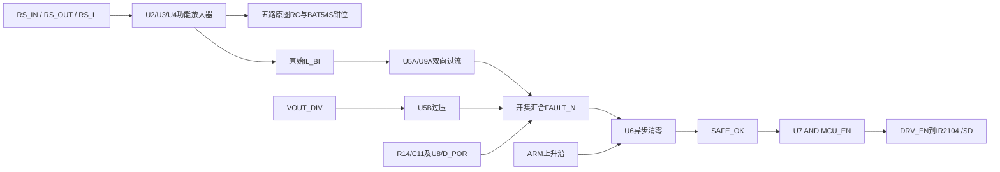
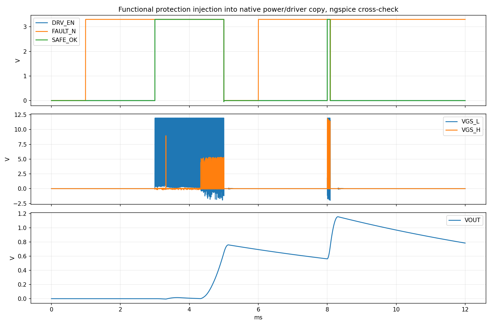

# Rev B采样与保护：首轮验证结果

日期：2026-10-24。来源为用户Rev B原图第3～6页、网络附录和BOM。本次实际运行ngspice功能模型，不是本环境运行Windows Multisim，也不是厂商有源器件模型或硬件认证。

**结论：采样、比较器极性、异步关断和故障锁存/ARM逻辑的19项独立功能检查均符合设定行为；接入Ki20功率/驱动后，两路栅极关断有效，但再ARM后发生再次过流，稳定恢复检查未通过。**

推荐先在本机打开[12ms诊断副本](../downloads/GBUCK_REVB_PROT_POS_INJECT_12ms.ms14)。这是内部功能模型副本，V_EN符号内部承载保护链，尚未把U2～U9逐个画在GUI中。操作和范围见[说明](../simulation/multisim14/native-project-check/protection-check/README.md)。

## 来源与连接核对

对照PDF提取表核对42个实际R/C的数值及两端网络、41处关键有源引脚与5个BAT54S中点接法。原图和BOM均保持。数据与源哈希见[来源审查](../simulation/multisim14/native-project-check/protection-check/results/data/source_audit.json)。

U4测电感电流而非输出电容后端负载电流。精确3.3V_A时IL_BI=1.65+0.5·IL，正/负参考2.55/0.75V对应±1.8A；U2/U3名义1V/A，电压分压11:1。该保护不能替代1A输出瞬时限流。

## 独立检查结果

| 检查类别 | 结果 |
|---|---|
| 输入/输出电流、电感电流、输入/输出电压的DC传递 | 5项通过，使用名义增益/零偏功能模型 |
| 正负过流与过压扫描 | 符合实际模拟电源和参考分压计算 |
| VIN ADC正负越界钳位 | 定性二极管模型范围约−0.262～3.567V，非MCU额定认证 |
| 模拟供电附加5/10mA假设负载 | 原R_VDDA造成门限随模拟电源下降 |
| 正向、反向、过压/小幅过压脉冲 | 4项触发、清零、保持、重新ARM序列通过 |
| ADC_IL电容4.7n→47n对照 | 保护原始IL_BI路径仍生效，不等同ADC滤波后触发 |
| MCU_EN/ARM断线默认、普通MCU禁用、高初始Q的复位 | 对应功能状态检查通过 |
| 100ns短过流输入脉冲 | 在假设1us放大器响应下未触发，按限制记录；不是逐周期短路保护通过 |

| 供电/负载假设 | 本模型3V3_A/V | 正向网格触发/A | 负向网格解除/A |
|---|---:|---:|---:|
| 仅参考网络负载 | 3.297502 | 1.799 | -1.798 |
| 另加5mA测试负载 | 3.247540 | 1.772 | -1.771 |
| 另加10mA测试负载 | 3.197578 | 1.745 | -1.744 |

扫描网格为1mA；基准过压触发约10.992V（1mV网格）。不把网格数写成器件精确阈值。实际芯片静态电流未取自数据手册，本次5/10mA为诊断负载假设。

原ADC RC的源阻抗也参与滤波：输入电压约47.43us、输出电压约8.97us、三个电流外部RC约4.7us；电流放大器自身动态另计。正/负参考约0.773ms、过压参考约0.697ms、上电POR RC为1ms。ARM前应等待参考建立并确认FAULT_N状态，不能只依据一个RC名义值。

按BOM参考电阻精度，加上“3V3_A±5%”研究假设的解析角点：正向电感阈值约1.708～1.892A，过压约10.286～11.733V。±5%不是未提供稳压器的规格；也尚未计入放大器/比较器偏移、温漂和实际供电负载。该结果提示需供电实测与误差预算，不直接要求改板。

## 耦合到功率/驱动：保留未通过项

本耦合诊断在5ms启动阶段施加故障，此时VOUT尚未升到10V；不用于10V稳态故障或短路能量验收。12ms交叉求解完整结束，共278172个数据点。3ms ARM使能；5～6ms仅注入等效+2.2A电感采样偏移，触发FAULT_N/SAFE_OK/DRV_EN；5.5～7ms ARM保持高跨越故障解除，驱动仍不恢复；新ARM在8ms短暂恢复，随后再次过流。此刺激不是实际功率短路。

| 耦合检查 | 结果 |
|---|---|
| off_before_ARM | 通过 |
| enabled_after_ARM | 通过 |
| fault_lowers_DRV_EN | 通过 |
| safe_remains_cleared_after_fault_release_with_ARM_high | 通过 |
| new_ARM_edge_initially_asserts_enable | 通过 |
| sustained_enable_after_reARM | **未通过** |
| no_retrip_after_reARM | **未通过** |
| both_gate_source_drives_low_while_latched | 通过 |
| low_gate_switching_before_fault | 通过 |

重新ARM前电流积分状态约0.197951；8～8.5ms内电感峰值约1.837511A，超过本模型约1.799A门限并再次拉低故障。停机积分状态与重启冲高相伴，提示控制恢复需进一步对照确认；未完成复位实验前不能认定唯一根因。独立锁存功能通过不能等同功率系统能稳定恢复。

已另建“停机积分状态复位/PWM禁止”实验副本，未覆盖原文件；两次交叉尝试达到90s执行时限，没有完整轨迹，不计为修复通过，也不把超时当成收敛失败。实验放在simulation目录的experimental下，不列入主推荐ZIP。真实固件尚未提供，未实现软件修复。

## F1与模型边界

- F1是输入端2A保险丝，不是1A负载限流，也不直接比较IL。BOM未指定厂商熔断时间电流/I²t曲线，本次不验证物理熔断时间。原生副本保留F1接入；交叉求解仅使用其1mΩ导通等效。
- 调节控制器仍用理想电压/电流反馈。新增五路ADC模拟端口只作观察与传递检查，未接成真实STM32 ADC采样/数字控制；量化、采样保持、电荷注入、固件延迟不在结果内。
- INA、LM393、HC14/74/08使用功能模型；1us/0.3us等动态及数值滞回为假设，不是厂商最大延迟。HC14比例阈值、掉电/供电丢失、共模瞬变抑制、器件偏置/温漂/损耗未认证。
- ADC钳位采用定性二极管参数；结果不构成真实MCU绝对最大电压/注入电流或全部通道的硬件合格证明。
- 没有完成真实短路能量、输入电源上电浪涌、原图采样/保护全链硬件或效率验收。

## 修改影响

| 比较基线与类别 | 本次影响 |
|---|---|
| 原PDF Rev B、BOM、PCB | 原样保留；无硬件连接/引脚/器件值更改，不新增采购器件 |
| 既有Ki20工程 | 不覆盖，功率/驱动模型与控制参数保留 |
| 新12ms诊断副本 | V_EN常量模板替换为功能保护链；增加理想辅助供电、ARM和采样故障刺激，时间100→12ms、测量选择改变 |
| 诊断画布 | 沿用功率级，保护在V_EN模板内部，不是逐芯片绘制的完整GUI原理图 |
| 模型RC等 | 仅计算假设，不是新增板上电阻电容；实际IC时序待后续核验 |
| 实验复位副本 | 控制模型状态处理有变，不改真实固件；整段求解未完成，未宣称已修复 |

当前步骤的验证已形成明确结果：保护动作/锁存功能成立于所列模型，稳定重启仍有未通过项。下一步本机先复核同样的注入波形，然后处理实际控制停机状态、重新ARM条件与重启软启动；不能提高过流门限来掩盖再触发。

[模型/操作/复现说明](../simulation/multisim14/native-project-check/protection-check/README.md) · [19项结果](../simulation/multisim14/native-project-check/protection-check/results/data/verification_summary.json) · [耦合结果](../simulation/multisim14/native-project-check/protection-check/results/data/coupled_native_verification.json) · [资料ZIP](../downloads/Multisim14_RevB采样与保护验证_2026-10-24.zip)。
