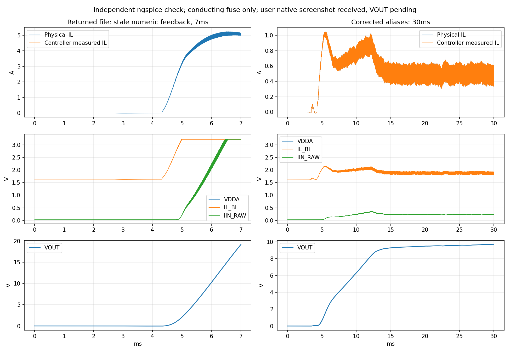

# STEP01采样接入：控制反馈别名修正

2026-10-25归档（调查始于10月24日）。依据用户实际回传GBUCK_STEP01_IL_SENSE.ms14.ms14核对并修正。原文件保存，不覆盖。

**结论：U2/U4采样极性、供电、参考与去耦接线正确；V3内部控制模板仍用已被网络别名替代的数字节点2/3，导致原理想控制器读不到真实电感差压。修正只改两个端口引用。**

## 本机下一步

用户已反馈修正版本机30ms截图，原约6A异常消失，VDDA约3.26V、零电流IL_BI约1.63V，采样与电感电流变化方向一致。后段电流仍有明显起伏，VOUT未显示，尚不能判为本机恒压/稳定性通过。下一步优先从已有结果添加V(VOUT)，再核对最大时间步长，避免盲目重算或调控制器。

暂不继续接比较器/锁存，先确认主回路电流回到受控范围且U4采样未贴近电源上限。如仍中止，保留完整报错与当前工程；本环境没有运行Windows Multisim。

本机截图电感峰值仅可粗读约1.4A，与独立求解峰值不完全一致；两者设置/引擎有差异，不混写数值。图示器自动缩放/抽点与实际纹波也需区分。未收到本机数值导出或峰值光标测量。

## 文件核对

| 实际内部节点 | 用户网络别名 | 含义 |
|---|---|---|
| 2 | L_RAW | L1之后、RS_L之前 |
| 3 | V_CAP | RS_L之后、输出电容正端 |
| 7 | 无新别名 | RS_IN之后的输入母线 |
| 4 | VOUT | RS_OUT之后 |

内部节点标识没有重编号；问题是导出网络名已改成别名，而V3自定义模板中的文字引用不会自动随绘图别名更新。

原调用：`XCTRL %t1 %t2 VOUT 3 7 2 GBUCK_CTRL_EQ`

新调用：`XCTRL %t1 %t2 VOUT V_CAP 7 L_RAW GBUCK_CTRL_EQ`

只替换活动模板及元件元数据中的两处调用。控制方程、Ki20、1A指令、10ms软启动、功率/驱动/INA模型均不改。输入母线当前仍导出为7，保持对应。

U2：IN+接RS_IN输入端，IN−接VIN，REF1/REF2为地；U4：IN+接L_RAW，IN−接V_CAP，REF1接VDDA、REF2接地。两颗VS均接VDDA，各100nF去耦已接地，NC脚均悬空；R_VDDA与五个模拟电源电容连接核对通过。

## 独立交叉求解

按实际网络别名提取用户电路和嵌入模型，使用ngspice PSpice兼容模式。未将提取的第三方功率/驱动模型另行发布为独立库。

- 原失配副本完成7ms；物理电感峰值约5.2277A，控制器内部电感电流读数为0，末点VOUT约19.1967V。复现了反馈失效机制，但不声称与用户截图逐点一致。
- 修正副本完成30ms，共886239点；电感峰值约1.0492A，末点VOUT约9.6682V。
- 25～30ms按时间积分的平均电感电流约0.493470A，输入分流器电流约0.237021A，平均输出电压约9.644929V。
- U4平均传递关系误差（IL_BI−VDDA/2−0.5IL）约-0.0001692V。

| 修正副本检查 | 结果 |
|---|---|
| VOUT_recovers_near_10V | 通过 |
| controller_sees_actual_inductor_current | 通过 |
| inductor_peak_below_2A_in_this_case | 通过 |
| IL_BI_average_transfer_error_below_10mV | 通过 |
| IIN_average_transfer_error_below_10mV | 通过 |

### 范围

- 完整30ms交叉求解使用梯形法、200ns最大步长；原生工程仍保留用户的自动最大步长及原初始条件/容差。不把它当成与本机相同的求解设置，也不据此认证纳秒边沿精度。
- 修正副本另以50ns梯形法推进到20.734ms后达到480s执行时限，未完成30ms；该段电感峰值1.077290A。保留限时记录，不把它认作收敛失败。
- Gear方法对照在约4.920ms发生步长过小，未完成，记录保留；未将原生文件改成Gear。
- 50ns与200ns结果在共同区间的降采样VOUT插值最大差约70.03mV，未达到附加50mV一致性目标。这里只比较平滑输出电压，不比较开关边沿或电流高频峰值；本轮不验收数值精度/稳定性。
- F1在交叉求解中仅用1mΩ导通电阻，不模拟热熔断/I²t。原生F1仍保留原2A器件，未短接、替换或提高额定值。原文件异常时本机熔断/中止行为不能由这个静态等效复现。
- 25～30ms正式平均值取完整轨迹时间积分；metrics中的tail_mean是按采样点平均的诊断量，不能混用。图及CSV降采样不用于认证全部高频峰值，峰值指标取完整轨迹。
- 新增U2/U4目前只供观察；Ki20仍用RS_L两端的理想差压反馈，尚未改成INA→ADC→固件控制。比较器与锁存保护尚未接入，不继承此前内部功能模型的保护通过结论。
- 临时SIM_3V3仍为独立测试源，不能以此结果判定整机效率、辅助电源性能或真实固件。

## 修改影响

比较基线为本次用户回传文件。

| 类别 | 本次影响 |
|---|---|
| 原理图连线/引脚/器件值/布局 | 全部保留，无修改 |
| 物理器件/BOM/PCB | 不新增、更换或改板 |
| 仿真模型 | 仅V3调用参数3→V_CAP、2→L_RAW；原控制方程和嵌入厂商模型不变 |
| 原生分析设置 | 时间30ms、自动最大步长、初始条件、容差、输出选择均保持 |
| 实际固件/保护 | 未修改、未新增；本次不验证真实MCU或保护器件响应 |

原生文件经两套DCL解码核对；精确逆变换证明除两处调用文字外其他XML字节相同。模型、元件参数/连接、分析设置另作比较。

- 原回传SHA256：`b1111a377c3ab83b075392189140fbc7a5ca782082280f712a3b1405cdac6f9c`
- 修正版SHA256：`ca8bc20a0ee8041834353e4b7ec91a6abc6ebd30451153d281b23aa82e6ac3b0`
- [构建与接线核对](../simulation/multisim14/native-project-check/step01-sense-feedback-fix/results/data/build_checks.json)
- [修正版完整30ms求解](../simulation/multisim14/native-project-check/step01-sense-feedback-fix/results/data/fixed_trap_200ns_verification.json)
- [失配对照求解](../simulation/multisim14/native-project-check/step01-sense-feedback-fix/results/data/original_alias_mismatch_verification.json)

同类Linux环境下运行build_fix.py，使用verify_coupled.py --trap-coarse复现200ns梯形法，再运行make_delivery.py。原对照数据已归档，默认verify_coupled.py可重跑7ms失配与50ns限时对照，--gear复现Gear失败。需要现有dclimplode/numpy/matplotlib和ngspice/XSPICE环境；最大执行时限可由STEP01_TIMEOUT_S覆盖。Windows用户直接打开原生工程，本环境未执行本机Multisim。
