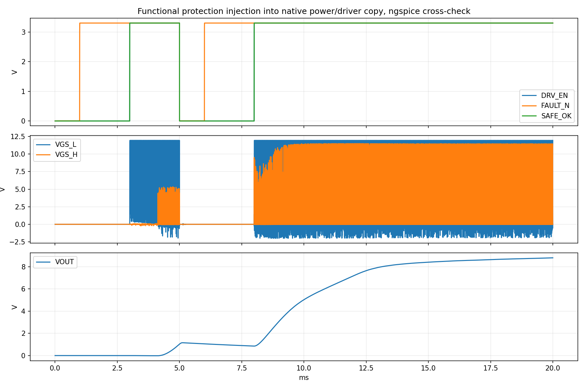

# 保护重启：停机积分冻结对照

2026-10-24。**此20ms功能模型对照通过。**原12ms失败基线保留；本轮仅改变停机期间两路积分器状态管理。未运行Windows Multisim，未修改或验证真实固件。

## 本机操作

打开[20ms对照工程](../downloads/GBUCK_REVB_PROT_FREEZE_20ms.ms14)，直接运行瞬态分析。原画布保留，保护仍在V_EN模板内；V3模板内有理想控制器，均不是逐芯片GUI重绘。

预选V(17)=DRV_EN、V(g_l)=下管VGS、V(vout)。需要时添加V(g_h)-V(sw)看高管VGS。不要用栅极对地电压代替高管VGS。

| 时刻 | 应观察的过程 |
|---|---|
| 3ms | 第一次ARM使能 |
| 5～6ms | 向IL采样正输入叠加55mV，模拟+2.2A表观故障；两路栅极应关断 |
| 6～8ms | 故障解除仍锁存停机，原ARM保持高不应恢复 |
| 8ms | 新ARM上升沿后检查是否恢复、是否再次触发 |
| 8～20ms | 观察是否持续使能；本轮仅验证这一窗口 |

这是启动阶段的采样偏移注入，不是10V稳态故障、真实短路或故障能量测试。辅助电源与偏移源的PWL在12ms后的最后值保持不变。

## 已运行结果

ngspice完成到20.000ms，共707927点。20ms末VOUT约8.792V，仍在恢复上升；本轮不判定已经恢复到10V稳态。

| 检查 | 结果 |
|---|---|
| off_before_ARM | 通过 |
| enabled_after_ARM | 通过 |
| fault_lowers_DRV_EN | 通过 |
| safe_remains_cleared_after_fault_release_with_ARM_high | 通过 |
| new_ARM_edge_initially_asserts_enable | 通过 |
| sustained_enable_after_reARM | 通过 |
| no_retrip_after_reARM | 通过 |
| both_gate_source_drives_low_while_latched | 通过 |
| low_gate_switching_before_fault | 通过 |
| no_fault_retrip_to_end | 通过 |
| enable_stays_high_to_end | 通过 |
| 停机状态保持（降采样轨迹5.3～7.9ms，变化小于1e-5） | 通过 |

| 全精度重新ARM窗口8～8.5ms | 原12ms基线 | 冻结对照 |
|---|---:|---:|
| ARM前电流积分状态 | 0.19795088 | 0.05204476 |
| ARM前电压积分状态 | -0.69056979 | 0.07388993 |
| 电感电流最大值/A | 1.83751082 | 1.38285725 |

电感窗口最大值取完整求解轨迹；状态保持检查来自降采样CSV。CSV不适合证明全部高频峰值。功能保护门限仍约±1.8A/11V，没有提高门限或旁路保护。

90s时限尝试推进到约10.83ms，240s时限推进到约19.30ms；均未导出完整数据，按执行超时保留，不认作收敛失败。随后依据进度提高执行时限，模型和求解设置不变。

## 修改影响

比较基线：GBUCK_REVB_PROT_POS_INJECT_12ms.ms14；其上游为Ki20的25V/20Ω工程。

| 类别 | 改动及影响 |
|---|---|
| 实物原理图 | 连线、引脚及器件值无修改 |
| 器件/BOM/PCB | 无新增、更换或改板要求 |
| 仿真V3控制模板 | 增加DRV_EN反馈端口；DRV_EN低于1.65V时，两路积分驱动电流置零，保留状态；仍有原1GΩ泄漏 |
| 使能期间控制 | 原Ki20电压/电流环方程与系数不变；未增加复位、重启斜坡或PWM禁止逻辑 |
| 保护、功率级、驱动模型 | 与12ms基线相同；F1仍仅按导通电阻交叉求解，无熔断热模型 |
| 分析设置 | 12→20ms，活动图名改变；其余原生求解选项保持 |
| 真实固件 | 尚未提供，未修改；若采用此策略，固件需显式实现停机状态管理，仿真改动不会自动进入MCU |

原19项独立保护功能检查的模型哈希保持，未更改这些测试的被测保护库。本对照只覆盖既定注入及20ms恢复，不能据此确认全部故障/负载的重启、1A输出瞬态限制、芯片最坏时序、效率或硬件。

## 文件与复现

依赖沿用native-project-check/requirements.txt及原ngspice环境。运行build_freeze_comparison.py，然后verify_coupled.py --freeze，最后make_freeze_delivery.py。默认本对照执行时限300s，可用REVB_COUPLED_TIMEOUT_S覆盖。

- 基线SHA256：`a5ce1f41512e52f59fd0ca44391ad5c656bcbd11a2a1b57b2143e2d8fe28a0c4`
- 对照SHA256：`b59746013f88037d1416a239acb07ad3d0a09c8f25a10ab5861c939823f8069b`
- [构建检查](../simulation/multisim14/native-project-check/protection-check/results/data/freeze_build_checks.json)
- [完整窗口判定](../simulation/multisim14/native-project-check/protection-check/results/data/coupled_freeze_verification.json)
- [保留原失败基线报告](Multisim14_RevB采样与保护首轮验证_2026-10-24.md)
