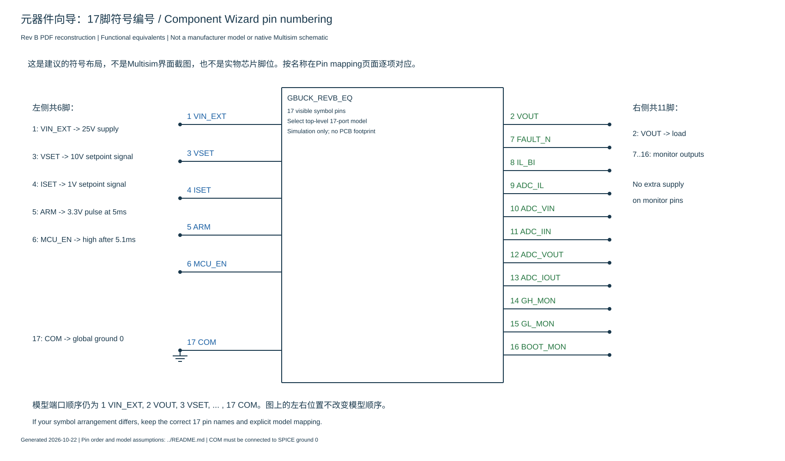

# Multisim 14.0 元器件向导逐页操作

本次要建立一个名为 **GBUCK_REVB_EQ、17个引脚、仅用于仿真** 的自定义元件。它把Buck功率级和功能控制模型封装成一个方框。以下按向导页面的功能说明；不同语言/版本的页面编号、按钮译名可能不同。当前没有操作用户本机的Multisim界面，不把示意图当成软件截图。

## 0. 先准备正确的模型文件

1. 下载当前修正版搭建包，在Windows中“全部解压”，例如解压至`C:\Multisim\G_Buck_RevB\`。
2. 找到`models\G_BUCK_RevB_EQ.lib`。**向导导入选这个文件**。
3. 可以用记事本查看：**第一行直接为`.SUBCKT GBUCK_REVB_EQ ...`**，前面没有说明注释、空行或标题；文件后部还有`.SUBCKT MOS_SWITCH_EQ`。当前文件是无BOM的ASCII文本。
4. `.lib`末尾的第二个子电路和`.MODEL`定义都要保留。它们是依赖模型，不是重复内容。

这里的`.lib`是SPICE文本模型，不是需要Windows安装的DLL。暂时不用`circuits\04_25V_8ohm.cir`：那是带外部电源与负载的完整测试网表，不是本步骤选用的元件模型文件。

## 1. 打开向导：Tools → Component Wizard

1. 打开Multisim，新建一张空白原理图。
2. 菜单进入`Tools → Component Wizard`，中文版寻找“工具→元件向导/组件向导”。
3. 后面遇到的页面按下列功能对应操作，不必要求右上角“第几步”完全相同。

## 2. Component information：基本信息

填写或选择：

| 项目 | 本次内容 |
|---|---|
| Component name / 名称 | `GBUCK_REVB_EQ` |
| Component type / 类型 | `Simulation only`，仅仿真 |
| Description / 描述 | 可填`17-pin synchronous Buck functional model` |
| Reference designator / 位号前缀 | 若提供此项，可沿用默认`U`；它不是模型端口名 |
| Author / Manufacturer | 可留空或填写自己的说明，不要把它当成厂家真实芯片模型 |

点击`Next / 下一步`。

如果后续要求选择DIP/贴片封装或PCB焊盘，先检查本页是否误选了“仿真和布局”。本模型不需要物理封装，也不应为凑引脚数套用18脚DIP封装。

## 3. Symbol：建立17脚矩形符号

这一步只建立画在电路图上的方框和连线端点。

1. 找到`Number of pins / 引脚数`，填 **17**。
2. 如果有section/gate数量，使用**单section、单个元件符号**。
3. 选择矩形符号；如果需要，点`Edit / 编辑`进入符号编辑器。
4. 检查共有17个连接端点，每个引脚号唯一，范围为1～17。
5. 若要调整布局，推荐左边6脚、右边11脚，按下图或下表放置。**位置只影响图面，最终电气对应由模型映射页决定。**
6. 保存符号并关闭符号编辑器，返回向导继续。

如果需要手动添加引脚，使用符号编辑器中的Pin/Terminal（引脚/端子）工具，再在其属性里设置编号与名称。单独用Text工具写出“VIN_EXT”文字不会建立电气连接端点。若向导已经自动生成17个真实端点，直接修改其名称即可。



| 放置边 | 从上到下的引脚号与名称 |
|---|---|
| 左边 | 1 VIN_EXT；3 VSET；4 ISET；5 ARM；6 MCU_EN；17 COM |
| 右边 | 2 VOUT；7 FAULT_N；8 IL_BI；9 ADC_IL；10 ADC_VIN；11 ADC_IIN；12 ADC_VOUT；13 ADC_IOUT；14 GH_MON；15 GL_MON；16 BOOT_MON |

如果默认符号已生成17个引脚，可以保留它的排列，直接按引脚号命名，不必为了和图中一致重画。若先选了现成18脚芯片符号，应改成17个实际端点，不要留下一个未映射的“第18脚”。

## 4. Pin parameters：引脚名称与属性

在引脚参数表中，按下面完整映射表填写`Pin name / 名称`。例如符号1脚叫VIN_EXT，符号2脚叫VOUT，17脚叫COM。

- 所有引脚都要可见，不要把COM或VIN_EXT设为隐藏电源脚。
- 保留普通连线型端点即可，ARM不必画成时钟三角形。
- 若提供`Passive / 无源`属性，可先把17个符号端点设为Passive，减少电气规则检查属性带来的干扰；这是本自定义模拟方框的符号属性，不代表实际芯片引脚都是无源。
- 若要求按输入/输出分类型：1、17为电源/参考端；3～6为输入；2和7～16为输出。使用模拟/SPICE模型，不要为ARM和MCU_EN额外建立数字仿真模型。
- 属性名称与端口映射不同；设置完属性后，后面的SPICE映射仍必须逐脚检查。

## 5. Simulation model：载入以.SUBCKT开头的完整模型

如果选中文件后提示**“数据模型要以.subckt或者.Model开头”**，对应的是模型数据开头检查，不能靠改扩展名解决。此前交付的.lib前5行是`*`开头的说明注释，本次已去掉这5行，电路正文保持不变。

不想重新下载时，可以用记事本打开旧.lib：删除从第一行到`.SUBCKT GBUCK_REVB_EQ`之前的所有内容，让`.SUBCKT`成为文件开头；从该行一直保留到文件最后，另存为纯文本。也可从该行起复制到文件末尾，粘贴到向导的可编辑模型数据区域，先清除原来的占位说明。不需要改成`.MODEL`，本模型是子电路。

修正版模型数据的前三行应是：

```text
.SUBCKT GBUCK_REVB_EQ VIN_EXT VOUT VSET ISET ARM MCU_EN FAULT_N IL_BI ADC_IL
+ ADC_VIN ADC_IIN ADC_VOUT ADC_IOUT GH_MON GL_MON BOOT_MON COM
+ PARAMS: FSW=100k DEAD=520n I5CTRL=0.06 I3BIAS=0.005 ETA5=0.85 ETA12=0.85
```

上面只是开头核对示例，**不能只复制这三行作为整个模型**。不要删除以`+`开头的续行，也不要在`.SUBCKT`前面添加网表标题或Markdown的三个反引号。

1. 到“仿真模型/SPICE模型”页面。
2. 若有Analog/Digital选择，选Analog（模拟）；若有SPICE模型类型，选择SPICE；若明确提供PSpice兼容选项，可选兼容方式。实际可选项以本机界面为准。
3. 找到`Load from file / 从文件载入 / Browse`一类按钮，选择本次修正版`models\G_BUCK_RevB_EQ.lib`。
4. 只有文件对话框看不到`.lib`时，才切换“All files / 所有文件”，或选择`models\G_BUCK_RevB_EQ.cir`。如果页面只有可编辑模型文本框，可用记事本打开`models\G_BUCK_RevB_EQ.txt`，复制**整个文件**进去。这三个副本逐字节相同，扩展名不同不代表模型语法经过转换。
5. 若显示可选择的子电路列表，选 **GBUCK_REVB_EQ**。
6. 检查顶层模型共有**17个端口**。如果只显示D、G、S三个端口，说明选到了内部辅助模型MOS_SWITCH_EQ，应返回选择顶层模型。
7. 模型中的FSW、DEAD、I5CTRL、I3BIAS、ETA5、ETA12是参数，不是引脚。不要把它们加到17脚符号里。
8. 如果提供模型语法检查按钮，可执行检查；有错误时先修复，不要一路忽略警告进入仿真。

**保留全文的检查点：**文件必须同时含有`GBUCK_REVB_EQ`和`MOS_SWITCH_EQ`两个`.SUBCKT`，以及各自的`.ENDS`和所用`.MODEL`。不要只保留第一个子电路，也不要把`.ENDS`当成多余的`.END`删掉。

若这个页面报“G的增益、PSpice/style/functional未知变量”，通常是把旧版完整`.cir`的说明标题带进来了。重新确认选的是当前包中的`.lib`，不要删除真正的GCORE、GAUX、G_XV等行为受控源。

## 6. Pin mapping：17脚逐项映射

这是最重要的一页。页面通常同时显示“符号引脚”和“模型节点/模型端口”。把每个符号脚对应到下面的端口名。

如果列表优先显示名称，按名称选；若只显示端口位置，按`.SUBCKT`的声明顺序：第一项VIN_EXT，第二项VOUT，最后一项COM。不要只根据符号在左边还是右边来判断，也不要把列表显示序号和SPICE全局地0混为一谈。

| 符号脚号 | 符号名称 | 必须对应的模型端口 | 首次搭建时外接内容 |
|---|---|---|---|
| 1 | VIN_EXT | VIN_EXT | 25V直流源正端 |
| 2 | VOUT | VOUT | 8Ω电阻上端 |
| 3 | VSET | VSET | 10V设定信号正端 |
| 4 | ISET | ISET | 1V设定信号正端 |
| 5 | ARM | ARM | 5ms开始的3.3V短脉冲 |
| 6 | MCU_EN | MCU_EN | 5.1ms后保持3.3V |
| 7 | FAULT_N | FAULT_N | 电压探针 |
| 8 | IL_BI | IL_BI | 可接电压探针 |
| 9 | ADC_IL | ADC_IL | 可接电压探针 |
| 10 | ADC_VIN | ADC_VIN | 可接电压探针 |
| 11 | ADC_IIN | ADC_IIN | 可接电压探针 |
| 12 | ADC_VOUT | ADC_VOUT | 可接电压探针 |
| 13 | ADC_IOUT | ADC_IOUT | 可接电压探针 |
| 14 | GH_MON | GH_MON | 高侧VGS监测探针 |
| 15 | GL_MON | GL_MON | 低侧VGS监测探针 |
| 16 | BOOT_MON | BOOT_MON | 自举电压监测探针 |
| 17 | COM | COM | Ground，全局地0 |

完成前检查：共17项；没有重复映射、未分配端口或第18脚；不要将14、15、16脚作为供电或控制输入，它们只是模型内部信号的缓冲监测输出。

## 7. Save component：保存到用户数据库

1. 数据库选`User Database / 用户数据库`。
2. 选择已有的可写自定义组；若提供“新增组/族”，可新建Group=`G_Buck`、Family=`Functional`，便于以后寻找。
3. 名称保持`GBUCK_REVB_EQ`，完成向导。
4. 使用`Place → Component / 放置→元件`进入元件选择窗口。
5. 数据库切换到User Database，在刚才的组/族中找到GBUCK_REVB_EQ，将它放到空白图纸上。

若完成后在Master Database中搜索不到它，先切回User Database。若不能保存，先确认所选数据库可写；不要通过随意改模型名来绕过实际的数据库权限或保存错误。

## 8. 放置后先检查符号，不急着运行

双击刚放置的元件，查看元件属性；若提供Model/SPICE model查看页，核对它关联的是GBUCK_REVB_EQ。

检查图纸上的引脚名称和编号：左边推荐1、3、4、5、6、17，右边推荐2、7～16。只看符号外形无法证明映射正确，应以上一步保存的映射为准。这里的一个方框已经含有功率级和功能控制网络，首个测试不需要在其输出再串接第二套Buck。

## 9. 连接首个25V/8Ω测试电路

按[接线图第4页](diagrams/Multisim14_仿真电路接线图.pdf)连接：

1. 放3个直流电压源，分别设25V、10V、1V。
2. 25V正端接1脚VIN_EXT；10V正端接3脚VSET；1V正端接4脚ISET。
3. 三个电源负端和17脚COM都接Ground。必须存在明确的全局地0。
4. 放8Ω电阻，上端接2脚VOUT，下端接地。
5. 放ARM脉冲电压源，正端接5脚，负端接地，参数见下表。
6. 放MCU_EN信号源，正端接6脚，负端接地。可采用下面的长脉冲方式，便于首次操作。
7. 2脚VOUT和7脚FAULT_N接电压探针。其它监测输出暂时可以不外接，不要统一接地；有驱动的输出端强制接地会改变电路或造成源冲突。

VSET=10V、ISET=1V是仿真控制量，不是给真实STM32引脚的电压。12V/5V/3.3V辅助轨在模型内部，外部只给VIN_EXT供电。

| 脉冲源参数 | ARM（接5脚） | MCU_EN（接6脚） |
|---|---|---|
| 初始/低电平 | 0V | 0V |
| 脉冲/高电平 | 3.3V | 3.3V |
| 延时TD | 5ms | 5.1ms |
| 上升时间TR | 10ns | 10ns |
| 下降时间TF | 10ns | 10ns |
| 高电平持续时间PW | 10us | 1s |
| 周期PER | 1s | 2s |

对应SPICE定义：ARM为`PULSE(0 3.3 5m 10n 10n 10u 1)`；MCU_EN长脉冲为`PULSE(0 3.3 5.1m 10n 10n 1 2)`。MCU_EN也可按原网表用`PWL(0 0 5.1m 0 5.101m 3.3)`。

如果脉冲源属性只提供频率和占空比：ARM对应1Hz、0.001%占空比；MCU_EN对应0.5Hz、50%占空比，仍需分别设5ms/5.1ms延时。占空比容易填错，首次尽量选能直接填写延时与脉宽的脉冲电压源。

## 10. 瞬态分析与预期结果

1. 打开Simulate菜单中的Transient Analysis（瞬态分析；部分界面位于Analyses/分析子菜单）。
2. 开始时间0，结束时间80ms，最大时间步长100ns。
3. 选择初始电容电压和电感电流为零的初始化方式，等效于UIC；若页面提供静态工作点初始化选项，不用它替代本模型的零初始状态。
4. 在输出变量页添加VOUT、FAULT_N等对应图纸节点的电压。若图纸用自动节点号，先用网标命名，或直接在界面选对应节点。
5. 运行。前5ms附近建立电源及ARM，5.1～6ms自举预充，6～16ms软启动，后面观察稳定值。

这个工况最终约8V/1A。因为8Ω负载已进入恒流，输出不是10V。外部负载电流按`VOUT/8`计算；ADC_IOUT包含板载泄放与分压电流，不等于严格的外部负载电流。

确认后，把负载改为20Ω，应回到约10V/0.5A；改为5Ω，应约5V/1A。相同设定由控制模型自动切换CV/CC，不要靠每换一个负载就手动改PWM。

最后用Save As在本机保存为`GBUCK_25V_8ohm.ms14`。这个文件由你的Multisim本机实际保存生成；下载包中不冒充提供原生.ms14工程。

## 11. 按现象定位

| 现象 | 优先检查 |
|---|---|
| 数据模型要以.subckt或者.Model开头 | 使用本次修正版；模型第一个字符应为.SUBCKT中的点，前面不能有旧版说明注释/空行/BOM；完整保留后续正文 |
| 模型只显示3个端口 | 误选MOS_SWITCH_EQ；顶层应为17端口GBUCK_REVB_EQ |
| 模型端口多于17，出现FSW/DEAD | 参数被当成引脚，先检查导入完整性及.PARAMS段解析，不能硬凑符号脚数 |
| G报PSpice/style/functional未知变量 | 选了旧完整.cir说明行；使用当前.lib或修正说明行注释 |
| 找不到MOS_SWITCH_EQ | 导入时丢失了文件后部的辅助子电路 |
| 找不到新元件 | 搜索数据库切换到User Database，检查保存的组/族 |
| 有输出符号但模型不运行 | 查看模型关联及17脚映射；外观正确不代表模型连接正确 |
| 输出一直0V，FAULT_N为高 | 查5脚ARM是否有真正的上升沿、6脚是否在5.1ms后变高 |
| FAULT_N始终低 | 查COM全局地、端口错接、零初始设置、完整模型是否解析成功 |
| 8Ω下约8V | 恒流工作点，属于预期行为 |
| IF/LIMIT或I(V...)仍报错 | 属于本机模型解析问题，保留完整报错再处理，不能靠改引脚号或忽略错误解决 |

这份步骤解决“如何在向导中正确建元件与接测试电路”。当前模型已在另一求解器核验，Windows版Multisim实际导入/运行、真实芯片时序与实物效率仍未确认。
