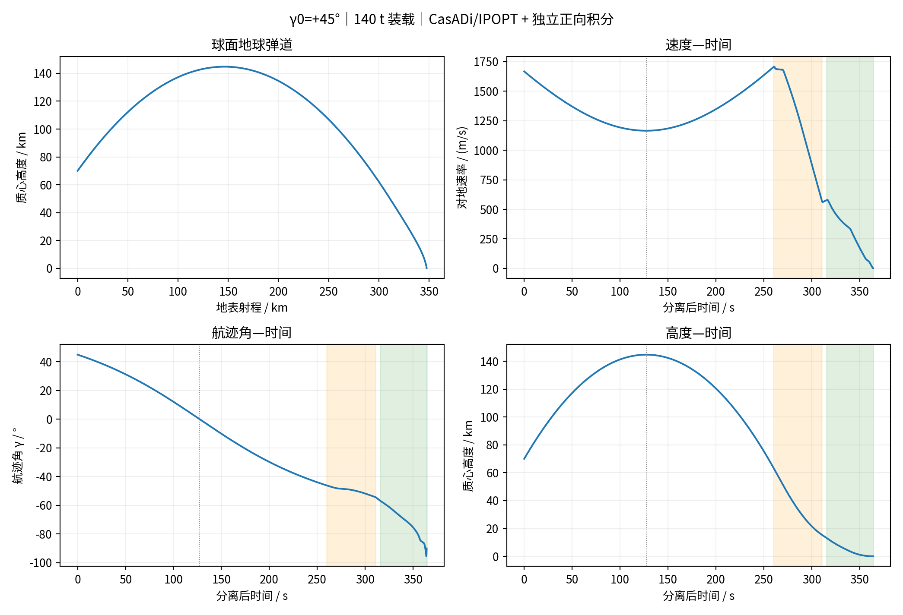
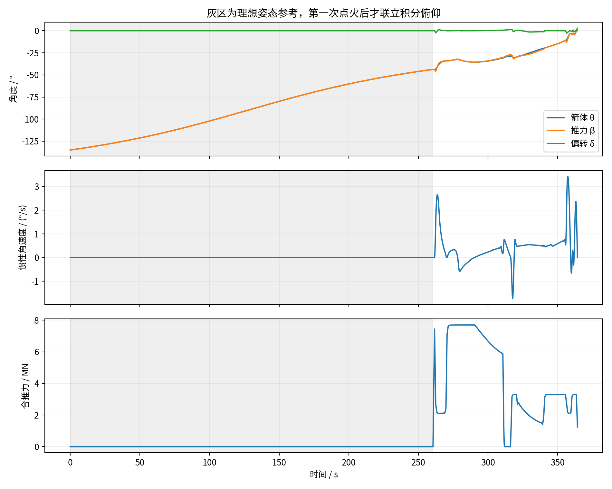
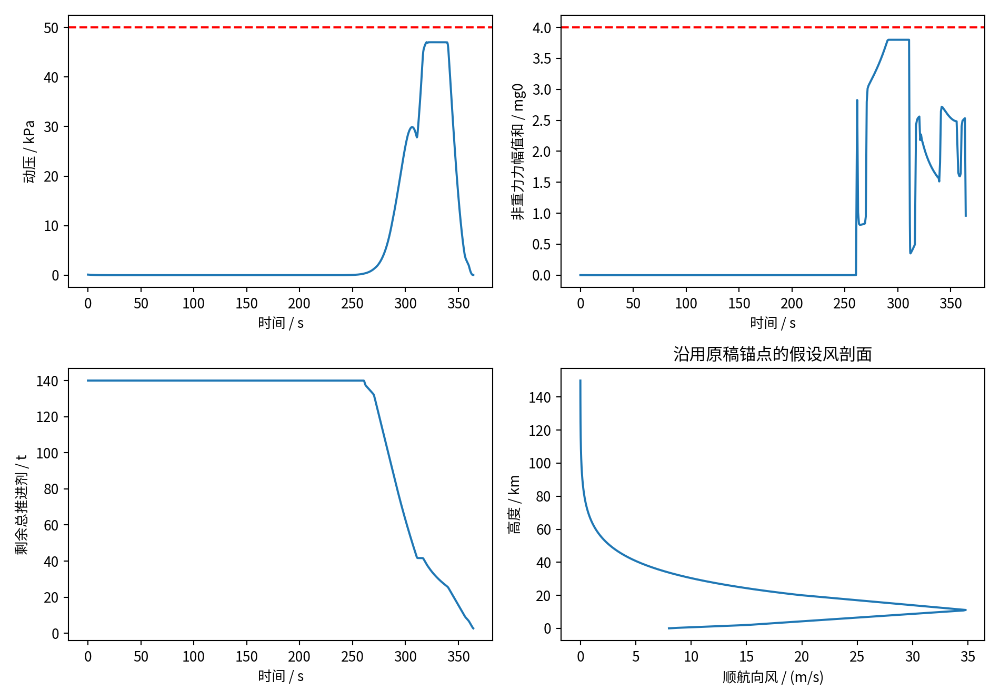
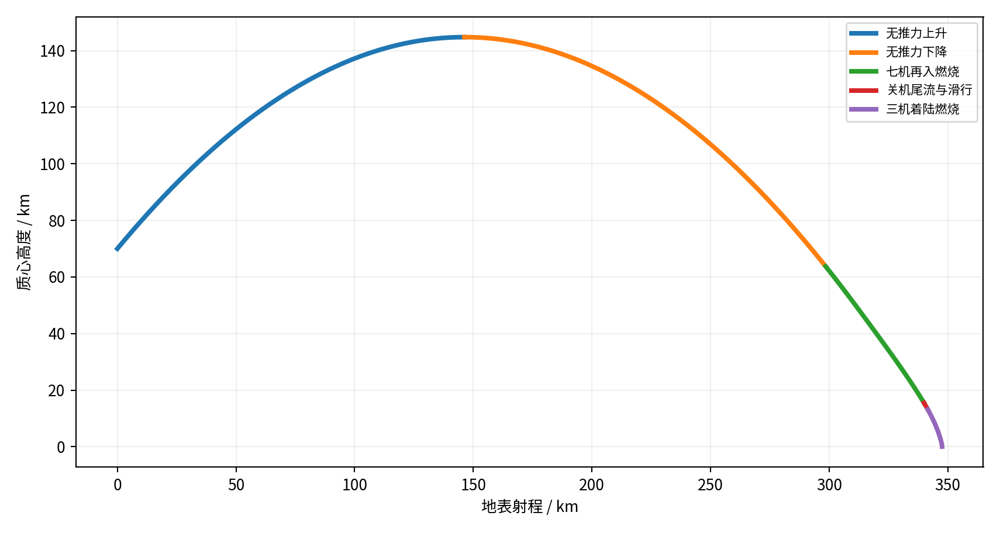

# 0. 修订结论

附件原稿已经采用γ₀=45°，本次按用户要求明确为**向上+45°**，重新建立并运行CasADi/IPOPT模型，而不是把水平分离算例的初速度直接套入旧结果。在本报告说明的模型与判据下，得到 **140 t初始推进剂**的名义回收候选：第一次耗剂 **98.308 t**，第二次耗剂 **38.942 t**，首次脚端触地剩余 **2.750 t**。

实际回放：远地点 **144.782 km**、约 **127.4 s**；首次点火 **260.00 s**；第二次点火 **315.64 s**；首次触地 **364.203 s**，射程 **347.624 km**，径向速度 **-1.0000 m/s**；峰值动压 **47.018 kPa**。

**这不是已证明的最小装载或鲁棒推荐。** 原稿104/96/102 t“数学/理论下限”和110/120 t“覆盖整套扰动”的结论，本次均不沿用。140 t是本次明确模型中的名义候选；较低装载的有限局部搜索未返回经验证的严格解，不能据此断言其物理上不可能。

新旧耗剂不能仅归因于优化器：本次修正曲率和动压公式，采用可复算Cd=0.5、俯仰联立约束、七机再入/三机着陆、脚端接触及储备条件。这些与附件的多个混合版本不同。全部修改位置见文末第12节。

# 1. 附件核查与初始条件

## 1.1 γ₀的定义与分量

航迹角从当地水平切线向上量取。70 km处的速度为6000/3.6 m/s，因此

$$ v_{t,0}=V_0\cos45°=1178.5113\ \mathrm{m/s},\qquad v_{r,0}=V_0\sin45°=1178.5113\ \mathrm{m/s}. \tag{1} $$

这表示先上升再下降，不能在分离时直接令vr<0。地球曲率与变重力使远地点约144.8 km；该处空气很稀薄，主要是引力将径向速度降至零。箭体依然保有约1.165 km/s切向速度，不是在远地点静止。

## 1.2 原稿中需要更正的关键问题

原文速度方程缺少球面局部坐标的曲率项；动压速度触发式多出Cd；推力角文字定义与正余弦分量不一致。“动压超过95%就满推力”也不是路径可行性证明，因为密度仍在增加且发动机有延迟。原稿还混用理想七机、单机末段、一阶姿态滞后与独立RCS量级分析，不能将它们的通过结果合并成完整安全证据。

当前附件没有提供所述booster_sim3d.py、attitude_analysis.py及12点Cd(M)数值，无法逐行复现原来的96–120 t结论。因此采用下面的显式参考模型，保留原稿存档，不伪造原曲线或计算记录。

# 2. 参数表与适用范围

G为用户给定或确认；L为文献常数/模型；H为情景假设；U为待定。H不是硬件实测值。

|性质|参数|采用值|出处与适用边界|
|---|---|---|---|
|G|干质量、总轴向高度、直径|130000 kg、65 m、7.0 m|用户题设；高度是否含支腿布局未给，几何另列H|
|G|分离高度、速率、航迹角|70 km、1666.6667 m/s、+45°|本次用户指定；正号表示向上|
|G|安装发动机数；氧燃比|7；液氧/甲烷=3.4|用户已确认；推进剂含液氧与甲烷|
|L|球形地球半径、引力参数|6371000 m；3.986004418e14 m³/s²|NASA/IERS [2,3]；非旋转球地球近似为H|
|L/H|密度模型|0至约86 km用USSA1976下层；以上指数延拓至220 km|[1]仅支持下层；延拓尺度高度7000 m为H|
|L|标准重力；大气位势半径|9.80665 m/s²；6356766 m|USSA1976 [1]|
|L|大气温度层与梯度|位势高度0/11/20/32/47/51/71/84.852 km；梯度−6.5/0/1/2.8/0/−2.8/−2 K/km|[1]；海平面288.15 K、101325 Pa；Rair=8314.32/28.9644|
|H|单机参考推力、比冲|1.0 MN；330 s，各高度固定|沿用附件参考值，不是实际发动机性能图谱；ve=3236.1945 m/s|
|H|稳态节流、启停|0.3–1.1；开启延迟0.5 s，一阶0.1 s，变化率≤1/s|范围与附件后期模型一致；动态参数未实测|
|H|启用组合|第一次7台，第二次中心机+相对环机共3台|本次策略族；不使用附件的末段单机悬停推断|
|H|气动系数、面积律|Cd=0.5；Aeff=A cos²α+455 sin²α|附件未给12个Mach锚点，故另定义可复算基准；A=38.48451 m²|
|H|沿航向风|0–0.1 km为8；2 km为15；11 km为35；20 km为20 m/s；高于20 km指数衰减|沿用附件锚点，分段线性连接；非实测或气象预报|
|H|转动惯量、压力中心|I=m(65²+3×3.5²)/12；压力中心位于质心上方5 m；Cmq=1|等效惯量和气动力矩假设，真实质量分布未知|
|H|安装及执行机构|轴向推力臂32.5 m、环半径2.5 m；万向节≤6°、速率≤20°/s|稳态燃烧推力惯性方向验收≤5°/s、优化收紧到4.5°/s；惯性俯仰速率≤10°/s|
|H|脚与甲板|质心至脚平面32.5 m；半展5 m；甲板半宽20 m、安全半宽18 m|非实测支腿；主体轮廓在脚平面上方2–65 m，沿轴1 m取点|
|H|推进剂不可用量与储备|初始装载0.5%不可用；另留三台最大推力1 s用量|储备3.3e6/ve≈1019.72 kg；优化另留50 kg|
|H|动压与力幅值和门槛|验收50 kPa、4；优化47 kPa、3.8|筛选目标，不是结构认证值|
|H|姿态与速度门槛|q≥10 kPa时迎角≤5°；低空倾角≤5°；触地倾角≤2°、角速率≤0.5°/s|脚端竖直速度绝对值≤2 m/s，水平≤0.5 m/s；优化目标vr=−1 m/s|
|U|真实硬件、三维天气及海况|未提供|Cd(M,α)、气动矩、喷流图谱、质心惯量、RCS、热防护、支腿与甲板运动需补充|

只保留二维平动与俯仰，不计算偏航、滚转、横风或船舶升沉。沿用原稿各高度的顺航向风，不把它称为某地实测或“典型”气候剖面。首次点火前按理想翻转/迎流参考处理，不积分RCS、不计RCS耗剂；点火后联立积分俯仰。未验证的翻转机构与冷气储备仍是模型边界。

# 3. 主动力学方程

## 3.1 球面局部平动与角度约定

取r=R+h，局部切向/径向速度为vt、vr，射程s=Rφ。β是推力从当地向上径向量取的角，正方向朝下游。θ为箭体发动机端指向头部的轴向角；δ=β−θ，ψ=θ+φ是惯性箭体角。

$$ \dot h=v_r,\quad \dot\phi=\frac{v_t}{r},\quad\dot s=\frac{Rv_t}{r}. \tag{2} $$

$$ \dot v_t=\frac{T\sin\beta+F_{a,t}+F_{j,t}}{m}-\frac{v_rv_t}{r},\qquad
\dot v_r=\frac{T\cos\beta+F_{a,r}+F_{j,r}}{m}-\frac{\mu}{r^2}+\frac{v_t^2}{r}. \tag{3} $$

$$ T=\sum_iT_i,\quad T_i=10^6u_i,\qquad \dot m=-\frac{\sum_iT_i}{I_{sp}g_0},\quad I_{sp}=330\ \mathrm{s}. \tag{4} $$

重力不“吃掉”地心角动量。船位自由只免除回发射场要求，仍需阻力和具有上游分量的推力制动切向速度。一般发动机推力包含喷气动量与出口压强项；本模型通过等效喷速ve=Isp g0统一表示，没有喷管参数，不能单独计算压强推力。

## 3.2 大气与风

下层大气使用USSA1976：位势高度H=Ra h/(Ra+h)，分层温度Ta=Tb+L(H−Hb)，由静力关系求压强，ρ=p/(Rair Ta)。L=0用指数压强式，其余用温度幂律。约86 km以上连续接

$$ \rho(h)=\rho(h_b)\exp[-(h-h_b)/7000],\qquad h_b\approx86\ \mathrm{km}. \tag{5} $$

式(5)是H类延拓，不是声称执行了USSA完整高空成分模型。需要更真实高空环境时应替换它；本例86 km以上最大动压约8.54 Pa，主要气动制动仍发生在低层。

沿用附件风锚点：高度0–0.1 km为8 m/s，在2、11、20 km分别为15、35、20 m/s，节点间线性插值。20 km以上w=20 exp[−(h_km−20)/15] m/s。只作用在切向，不额外叠加一份“海风力”。

$$ \mathbf v_a=\mathbf v-w(h)\mathbf e_t,\quad V_a=|\mathbf v_a|,\quad q=\tfrac12\rho V_a^2,\quad D=qC_DA_{eff},\quad \mathbf F_a=-D\frac{\mathbf v_a}{V_a}. \tag{6} $$

$$ \cos\alpha=-\mathbf v_a\cdot\mathbf e_b/V_a,\quad \sin\alpha=\mathbf v_a\cdot\mathbf e_p/V_a,\quad A_{eff}=A\cos^2\alpha+455\sin^2\alpha. \tag{7} $$

按这里的约定，发动机端迎流时α≈0°；箭体方向与推力轴大致同向，喷流方向大致相反。面积律为H，不能替代真实Cd(M,α)或反推气动数据库。

动压阈值给出的空速条件是Va≤√(2qlim/ρ)，不含Cd。其演化还受密度变化影响：

$$ \dot q=\tfrac12\dot\rho V_a^2+\rho\mathbf v_a\cdot\dot{\mathbf v}_a. \tag{8} $$

所以满推力并不自动保证未来峰值q不越界，必须积分并查验路径。

## 3.3 俯仰、差动节流与质量流出近似

采用等效圆柱惯量I=mK²，K²=(65²+3×3.5²)/12。每台发动机在质心下ℓ=32.5 m，横向坐标ai由中心+六环给出；着陆启用中心与相对环机一对。令S1=ΣaiTi，S2=Σai²Ti，平均节流与差动控制为

$$ u_i=\bar u+(a_i/2.5)d,\qquad \dot\theta=\omega-\frac{v_t}{r},\qquad \dot\psi=\omega. \tag{9} $$

$$ I\dot\omega=M_T+M_a+M_j+M_{gg},\quad M_T=-\ell T\sin\delta-S_1\cos\delta. \tag{10} $$

$$ M_a=-5D\sin\alpha-\frac{qA65^2}{2V_a}\omega,\quad
M_j=-\frac{T(\ell^2-K^2)+S_2}{v_e}\omega. \tag{11} $$

$$ \mathbf F_j=\frac{\omega}{v_e}(\ell T\mathbf e_p+S_1\mathbf e_b),\quad
M_{gg}=-\frac{3\mu}{2r^3}\left(I-\tfrac12m3.5^2\right)\sin2\theta. \tag{12} $$

这些是点喷口、固定几何和等效惯量下的简化变质量闭合，包含选定的流出转动效应；不包含真实内部液体流动、质心迁移、有限喷口半径与晃动，不能冒充完整多体模型。变质量理论背景见[8]，本箭具体参数仍为H。

## 3.4 有限启停与余量

开启命令后0.5 s无推力，随后实际节流先以1/s爬升到1，再按0.1 s时间常数趋近1.1。稳定控制段采用分段线性实际u，重建命令uc=u+0.1 u̇；逐台检查u、uc∈[0.3,1.1]、|u̇|≤1/s。关机实际u连续下降，并有指数尾流，允许低于0.3，不能瞬间清零。

$$ u_{on}(\tau)=\begin{cases}0,&\tau\le0.5,\\\tau-0.5,&0.5<\tau\le1.5,\\1.1-0.1e^{-(\tau-1.5)/0.1},&\tau>1.5.\end{cases} \tag{13} $$

$$ s_0=\max(u_0-0.1,0),\quad u_{off}(\tau)=\begin{cases}u_0-\tau,&\tau\le s_0,\\\min(u_0,0.1)e^{-(\tau-s_0)/0.1},&\tau>s_0.\end{cases} \tag{14} $$

不可用量为初始推进剂0.5%，保留为质量；终端可用储备至少为三台最大推力一秒所需质量，另加50 kg数值缓冲。第一次关机尾流计入第一次耗剂；第二次耗剂只计到首次脚接触，之后需用剩余储备执行关机，未在本次模拟接触后支撑。

# 4. CasADi/IPOPT实际求解方法

直接多重打靶联合优化质量、阶段时长、逐节点平均节流、差动节流与万向节角。自由质量目标为初始推进剂加小正则项；固定装载时最小化消耗加小正则项。正则系数1e−5，求解为非凸局部NLP，不是全局最低燃料证明。[4,5]

策略为无推力滑行→七机燃烧→关机命令→至少5 s后发出三机点火命令→着陆燃烧。初步同时探索首次点火230–300 s；最终验证候选固定首次点火260 s。第一、第二燃烧稳态时长范围5–110 s及5–160 s，关机间隔5–100 s，终止时间260–500 s。

最终稳态控制每段60区间，每区间4次RK4子步；启动0.05 s节点，关机最初2 s用0.0125 s子步。滑行段由原40个节点加密至160个节点。IPOPT容差1e−7、可接受容差1e−5，最终固定质量迭代预算1000。输入与输出均随代码归档。

主要路径/终端门槛：q≤50 kPa，nΣ=(T+D+|Fj|)/(mg0)≤4；优化分别收紧至47 kPa、3.8。高动压迎角和质心高度≤232.5 m时的低空姿态分别限制在5°以内，优化低空进一步收紧到3.5°以留插值余量。迎角优化还采用保守连续条件max(q−1000,0)(1−cosα)≤9000(1−cos5°)，q以Pa计。

目标为vt=0、vr=−1 m/s、θ=ω=0，脚端首次触地。脚端竖直速度绝对值≤2 m/s、水平≤0.5 m/s，触地倾角≤2°、角速率≤0.5°/s，两脚在船中心±18 m内，主筒不先碰甲板，并满足推进剂储备。这里的过载是非重力力幅值和上界，不是结构认证或航迹法向过载。

# 5. 更新的名义结果与阶段说明

|阶段|时间/s|高度/km|地速/(m/s)|耗剂/t|
|---|---|---|---|---|
|无推力上升|0.00–127.40|70.000→144.782|1666.7→1164.95|0.000|
|无推力下降|127.40–260.00|144.782→63.738|1165.0→1702.26|0.000|
|七机再入燃烧|260.00–310.64|63.738→15.478|1702.3→571.65|97.503|
|关机尾流与滑行|310.64–315.64|15.478→13.136|571.7→577.81|0.805|
|三机着陆燃烧|315.64–364.20|13.136→0.032|577.8→1.00|38.942|

本次第一次燃烧并不固定在75–55 km之间，而是从约63.74 km一直制动至约15.5 km；它承担了比原稿短再入点火更大的一部分制动任务，不能把两个版本的“第一次耗剂”当作同一任务直接比较。

上升段是引力导致径向速度减小的过程，速率下降到远地点的切向速率；下降段重力再加速。七机燃烧提前在稀薄大气中主动降低能量，以满足后续最大动压和迎角约束；其后短间隔仍含关机尾流。三机末段继续消减切向和径向速度，并将箭体竖直化，不能将整个末段叫作匀速下降。

|项目|总推进剂/t|甲烷/t|液氧/t|
|---|---|---|---|
|初始装载|140.000|31.818|108.182|
|第一次点火至第二次点火，含关机尾流|98.308|22.343|75.965|
|第二次点火至首次脚端触地|38.942|8.850|30.091|
|首次触地剩余|2.750|0.625|2.125|

氧燃拆分采用mCH4=mp/4.4，mLOX=3.4mp/4.4。剩余推进剂含不可用量和关机/应急储备，不能全部视作可自由消耗量。

第一次最大合推力约7.699 MN，第二次约3.300 MN。首次主要朝斜上游，第二次逐渐转向天顶；β<0为上游分量。瞬时角度、推力、质量流随时间变化，以CSV为准，不用一个峰值代表全程。主轴喷出气体方向与推力相反。推力积分与耗剂满足J=ve Δm；特征速度积分满足ΔvT=ve ln(m0/mf)，但不等于净速度变化。

首次触地质心仍在海面上约32.5 m。两脚速度及位置按刚体旋转速度计算，未将角速度或推力在接触时清零。船仅在名义射程选择一次，扰动中不移动去追落点。

# 6. 更新图像

# 7. 装载与局部搜索结果：为什么不能称数学下限

|初始装载/t|本次有限局部搜索|预算|
|---|---|---|
|90|未返回经验证的严格解|N=30，迭代上限90|
|100|未返回经验证的严格解|N=30，迭代上限90|
|110|未返回经验证的严格解|N=30，迭代上限90|
|120|未返回经验证的严格解|N=30，迭代上限90|
|130|未返回经验证的严格解|N=30，迭代上限90|
|140.0|最终名义独立回放通过|N=60；固定首次点火260 s|

90–130 t均只进行了规定预算的局部求解；没有全局不可行证明。140 t是按10 t递增得到的首个本次验证候选，不等于所有模型下的最低装载。达到首个名义可行候选后停止增加质量，未把附件90–200 t旧表伪装成本次重新优化结果。

连续质量及首次点火时刻探索的实际返回如下：

|搜索设置|返回初始推进剂/t|首次点火/s|证据边界|
|---|---|---|---|
|固定260 s，30区间|139.331|260.000|仅NLP候选，非全安全验收|
|固定260 s，60区间|137.612|260.000|仅NLP候选，非全安全验收|
|首次点火230–300 s，30区间|139.223|264.039|仅NLP候选，非全安全验收|
|首次点火230–300 s，60区间|149.367|244.191|仅NLP候选，非全安全验收|

同一物理假设下，不同离散度与暖启动返回不同局部分支；并非自由时间优化必然优于一个固定时间局部解。不能把这些数取最小就当作完整安全答案，也不能把NLP返回就当作脚端着陆已通过。最终另将140 t、260 s分支加密滑行段并独立验证。连续质量搜索没有全局性保证，也没有形成严格网格收敛证明。第一次滑行加密候选在连续回放中发现推力方向速率短暂达到5.13°/s，超过5°/s；该候选被拒绝，随后将节点优化门槛收紧到4.5°/s并独立重算，最终只采用修订控制。

一次联合时间/质量求解后的后续固定质量重算，以及并行进行的一次滑行加密重算，因进程退出137而未完成，未将其记作收敛或可行。后续采用独立进程完成最终候选，实际日志保留。

# 8. 程序验证与固定开环扰动

## 8.1 独立验证

优化器用球面局部状态与km/t/MN缩放；验算使用独立SI地心笛卡尔方程和SciPy DOP853，不调用CasADi动力学。[6] 强制经过控制切换节点，密集采样0.05 s，以连续脚端净空根事件求首次接触或可用推进剂耗尽。船按静止海平面切平面定位，球面脚接触与局部平面的差约2微米；这不是海浪模型。

已通过所选名义检查。最大动压47.0177 kPa，nΣ最大3.80025；高动压区最大迎角4.9836°，低空最大倾角3.7437°，最大万向节2.7452°；稳态燃烧惯性推力方向变化率最大4.6131°/s。

80组随机状态的独立坐标导数核对，最大分量绝对差约2.46e-10（各分量按其SI单位）；同时检查实际节流、重建命令、变化率与关机流量积分。独立积分步长从0.1 s减至0.05 s，触地时间差4.5e-06 s，射程差2.97e-05 m，径向速度差2.37e-06 m/s，质量差0.00172 kg。数值一致性不代表真实气动、执行机构和质量特性已经验证。

## 8.2 对原“鲁棒推荐”的重新检查

保留本次初始质量、控制曲线和船位，只改单一或组合参数，积分到首次脚端海面事件、可用推进剂耗尽或原计划终止时刻；不在计划外延长着陆控制。结果如下：

|固定控制扰动|终止事件|高度/m|vr/(m/s)|峰值q/kPa|检查子集|
|---|---|---|---|---|---|
|Cd −15%|contact|32.8|-120.83|53.82|未通过|
|Cd −20%|contact|32.7|-145.54|56.38|未通过|
|Isp −2%|usable_propellant_exhausted|462.6|1.59|44.79|未通过|
|风 ×2|time_limit|174.9|-2.41|45.91|未通过|
|风 ×3|time_limit|321.9|-3.78|44.77|未通过|
|组合：Cd−15%/Isp−2%/风×2|contact|32.9|-44.63|49.11|未通过|

这些是固定开环诊断，不是闭环制导或重规划的性能试验；未通过只说明这套固定计划不能直接用于这些扰动。不能反向推断原附件未提供源码的控制器必然同样失败，也不能将六个确定性案例换算成概率。由于没有通过这些扰动，140 t不称作鲁棒推荐，不能简单加固定8 t就宣称鲁棒。

# 9. 姿态、接触与安全边界

七机最低稳态推力2.1 MN大于近干重，三机最低0.9 MN则低于干重约1.275 MN；选三机便于末端向下速度控制。单机最大1.1 MN不足以在近地低速时悬停或向上净加速，但这不等于证明任何单机短时弹道接触都不可能。发动机组合仍是策略假设，不是穷举最优结论。

脚端位置rf,±=r−ℓ eb±b ep，速度vf,±=v+ω(−ℓ ep∓b eb)。主筒代理从脚平面上方2 m到65 m，每1 m取侧轮廓及端点，判别谁先接触。几何是H，真实喷管、支腿部署、柔性变形和碰撞未给。过载、动压通过并不等于应力、热防护、底部喷流载荷或接触后稳定通过。

点火前理想翻转没有RCS耗剂；点火后俯仰虽已联立，仍取假设压力中心、阻尼和等效惯量，未验证实机。姿态跟踪率小于某阈值不等于有足够转矩与控制带宽；不能沿用“22倍姿态余量”的结论。RCS真实质量与耗剂如需加入，必须在总质量和推进剂账中重新闭合。

模型还不含三维横风、地球自转、海浪和运动甲板，未模拟接触后的支腿压缩、摩擦、抗倾覆及关机尾流作用，也未计算结构应力或热流。它是受约束的名义研究算例，不是实际回收能力或安全成功率证明。

# 10. 参考资料与计算文件

[1] NOAA/NASA/USAF. U.S. Standard Atmosphere, 1976. NASA-TM-X-74335. https://ntrs.nasa.gov/citations/19770009539 。支持下层分层大气，不支持本报告的高空指数延拓。

[2] NASA NSSDC. Earth Fact Sheet. https://nssdc.gsfc.nasa.gov/planetary/factsheet/earthfact.html 。平均地球半径。

[3] Petit and Luzum, eds. IERS Conventions (2010), TN36. https://iers-conventions.obspm.fr/conventions/content/tn36.pdf 。地球引力参数。

[4] Andersson et al. CasADi: a software framework for nonlinear optimization and optimal control. Mathematical Programming Computation 11:1–36, 2019. https://doi.org/10.1007/s12532-018-0139-4 。软件与方法。

[5] Wächter and Biegler. On the implementation of an interior-point filter line-search algorithm for large-scale nonlinear programming. Mathematical Programming 106:25–57, 2006. https://doi.org/10.1007/s10107-004-0559-y 。局部NLP算法，不提供全局最优保证。

[6] SciPy. solve_ivp documentation. https://docs.scipy.org/doc/scipy/reference/generated/scipy.integrate.solve_ivp.html 。DOP853与事件积分。

[7] Marwege et al. Hypersonic retro propulsion for reusable launch vehicles tested in the H2K wind tunnel. CEAS Space Journal 14:473–499, 2022. https://doi.org/10.1007/s12567-022-00457-w 。说明反推流动的复杂性，未移用其实验系数。

[8] Gäßler et al. Variable-Mass Dynamics Implementation in Multi-Physics Environment for Reusable Launcher Simulations. EUCASS2022, DOI10.13009/EUCASS2022-6124. https://www.eucass.eu/doi/EUCASS2022-6124.pdf 。变质量动力学背景；本文几何与内部流动近似另列H。

[9] NASA Glenn. Specific Impulse. https://www1.grc.nasa.gov/beginners-guide-to-aeronautics/specific-impulse/ 。质量流率、推力与等效喷速关系。

原稿其他文献未被用作本次参数定量依据；对本次未能访问核验的条目，不声称已验证正确，也不直接判为伪文献。原稿题给数据与用户补充确认是G类输入来源。

# 11. 可复现文件与交付说明

simulation/内含CasADi/IPOPT求解器、独立SI回放、标准大气/高空延拓、分析绘图、随机坐标与执行器验证及报告生成代码；results/data/含最终控制NPZ、逐时刻CSV、阶段耗剂、参数、搜索和扰动记录；results/logs/保留成功、未收敛及资源退出记录；原稿完整保存在references/。安装版本、运行命令见README。

本次真实执行了优化与回放，不是只替换文案中的求解器名称。未提供的原脚本没有被假装“修复并重跑”。若未来取得原12点Cd(M)、真实执行机构和质量特性，应使用同一数据重算再比较燃料，届时140 t也应随模型更新。

# 12. 与原稿相比修改了哪些地方

本节是本文件最后的修改记录。原稿按章节与公式图片编号定位；原稿文件同时保留供逐项对照。

|原稿位置|原表述或问题|本次修改|
|---|---|---|
|封面、表0、§0|原稿已写γ0=45°，但各版本结论混用|统一为γ0=+45°向上分离，给出vt0=vr0=1178.511 m/s；新结论只引用本次实际计算|
|§1.1–1.2及原公式图1–3|称球面模型，但速度方程没有曲率项，β文字与分量写法不一致|补−vr vt/r与+vt²/r；统一β从当地天顶量起；推力分量为T sinβ、T cosβ|
|§1.3、参数表、远地点|约143 km远地点；>86 km模型未充分定义|USSA下层加连续指数密度延拓，尺度7 km明确标H；独立计算远地点约144.8 km|
|§1.3、§9.1|提到Cd(M)12锚点但未提供数值；面积律与姿态模型分散|主算例显式采用Cd=0.5并保留迎角面积律；这是模型变更，不是对原曲线的复现|
|§1.4及原公式图7|动压触发速度公式含Cd，且称强制满推力保证不越界|改用q=ρVa²/2，去掉错误Cd；直接施加路径约束并独立查峰，满推力不再被称为保证|
|§1.4、§5与§9.3|七台微弱节流及7→3→1混用，末段单机能力解释不足|采用7→3、两次点火策略；1.1 MN小于干重约1.275 MN，单机不具备近地低速悬停/向上加速能力；不据此排除所有单机短时弹道接触|
|§7.2及§9.1|独立RCS量级分析、一阶姿态滞后后断言“姿态不是瓶颈”|点火后联立俯仰、TVC和差动节流；点火前仍是理想翻转参考；撤回真实姿态余量和605 kg冷气结论|
|§7.3与原表12|参数化喷流敏感性被表述为已补完整证据链|本次没有喷流CFD/风洞标定，不输出“影响仅1 t”的结论；热流与底部载荷仍待验证|
|§8.1–8.3|称没有CasADi/IPOPT，使用Powell罚函数|改为实际可运行的CasADi/IPOPT直接多重打靶；记录成功、局部解差异及未完成的运行|
|§3.5–3.6、§8.4、§9.5|104/96/102 t称理论或数学下限；110/120 t称鲁棒推荐|撤回无全局证明的下限及缺乏本次复算支持的鲁棒结论；报告140 t参考候选与搜索预算|
|§3各图、§4阶段表、§5耗剂表|旧图表含多个模型版本的数值|全部换成本次独立SI回放的轨迹、速度、航迹角、高度、姿态、推力、阶段和耗剂结果；旧图表随原稿存档|
|§6风及原扰动表|用少量固定扰动结果推断通用鲁棒能力|沿用风锚点但标H；六个固定开环扰动单独复算，不作为概率或闭环能力判断|
|§9–10的启停与局限|一处声称已实现节流/延迟，另一处又称没有这些限制|统一保留逐台节流、开启延迟、关机尾流、一阶响应及速率限制，局限只列仍未实现的内容|
|执行器连续验收|本次初次候选节点满足5°/s，但节点间出现约5.13°/s|拒绝初次候选，将优化速率收紧到4.5°/s、验收仍5°/s，最终图表全部重算|
|首次触地与关机表述|触地h=0且发动机立即关机，未区分质心和脚|用脚端连续零事件，质心触地高度约32.5 m；预留关机储备但不声称已模拟支腿压缩与停稳|
|引用与可复现性|仅有文稿，未随附所述tools脚本及完整锚点|提供此次实际代码、控制节点、逐时CSV、验证JSON与日志；未核验旧引用不作为新参数数据依据|

比较基线：用户上传《回收仿真_七机两段点火.docx》。本次修改涉及物理模型、控制等效、环境、优化与验算程序、图表及文字；原理图连接/引脚/器件值、器件/BOM、PCB和固件均无变更。本算例不为任何真实硬件或固件提供验证结论。
