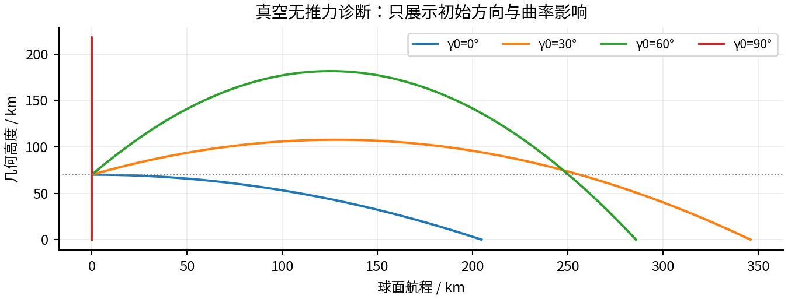
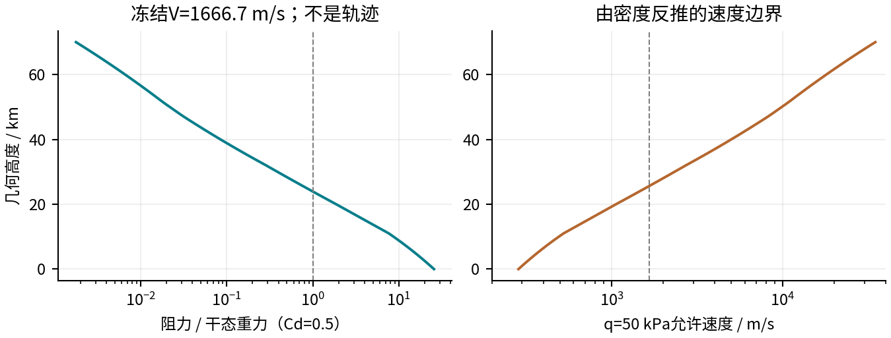

# 2026 UPC A题：量级分析与建模取舍：无推力弹道与燃料参照增补版

一级助推器海上回收 · v5增补版 · 2026年11月7日（北京时间）

> 主模型应保留：变质量、有限推力/响应、分层大气、地球曲率与重力。可先用二维质点求参考方案；实际姿态、脚端接触、横风和地球自转需要独立核查。部分效应对燃料粗估只有百分比影响，却足以破坏米级着陆精度。

### 1 分析口径与基本尺度

题目给定高度70 km、速率6000 km/h、干质量130 t、长度65 m、直径7 m。参考Isp=320 s、Cd=0.5、单台1 MN等效推力及2台最大2.2 MN均沿用v2的H假设；130 t只作为干态极限参照，实际制动质量更大。

表1  基本量级

| 量 | 计算 / 数值 | 直接含义 |
| --- | --- | --- |
| 初始速度 | V₀=1666.667 m/s | 题目给的是大小，方向需参数化。 |
| 初始比动能 | V₀²/2=1.389 MJ/kg | 惯性不可忽略。 |
| 重力势能下降 | GM(1/R−1/(R+h₀))=0.680 MJ/kg | 约为初始动能49%；重力必留。 |
| 真空无推力地表速率 | √(V₀²+2ΔΦ)=2034.13 m/s | 能量诊断，不是实际落地速度。 |
| 自由下落时间尺度 | √(2h₀/g_mid)≈120.1 s | 重力速度尺度约1.17 km/s。 |
| 干态机械能尺度 | m_d(V₀²/2+ΔΦ)≈269 GJ | 仅折算干质量，不是燃烧化学能。 |
| 等效排气速度 | v_e=Isp g₀=3138.13 m/s | V₀/v_e≈0.531，变质量可能显著。 |

### 1.1 量级分析不直接给出燃料答案

这些量解释为什么某些物理项不能省略。大气可耗散机械能，发动机推力方向与时序也影响耗剂；不能把269 GJ除以燃料热值求所需质量，也不能直接把2034 m/s或V₀当作发动机必需Δv。实际总推进剂仍须由受约束轨迹求解。

## 2 重力、曲率与地球自转：小参数的用途不同

海平面球对称g=9.82025 m/s²，70 km处为9.60796 m/s²，相差2.16%。若全程取海平面g，势能下降被高估约1.10%；变重力成本很低，建议直接保留。h₀/R≈0.011本身较小，却不足以证明长航程可以取平地。

表2  无推力真空方向情景

| γ₀ / ° | 真空落地时间 / s | 球面航程 / km | 最高几何高度 / km |
| --- | --- | --- | --- |
| 0 | 123.3 | 204.7 | 70.0 |
| 15 | 178.8 | 285.7 | 80.1 |
| 30 | 243.2 | 346.0 | 107.6 |
| 45 | 304.4 | 350.8 | 144.8 |
| 60 | 353.4 | 285.8 | 181.5 |
| 90 | 395.4 | 0.0 | 217.9 |

图和表：仅中心重力、无空气/推力/自转的诊断，不是安全返回方案。γ₀≥30°已达到约108–218 km，说明70 km不是所有情景的高度上限。

γ₀=0°真空航程约204.75 km，对应切平面与球面偏离尺度s²/(2R)≈3.29 km；初始球坐标曲率项V_t²/r≈0.431 m/s²，为当地g的4.49%。因此全程保留球面几何，只有局部末段可用平地坐标。

由地球恒星日得Ω≈7.2921×10⁻⁵ rad/s，2ΩV₀≈0.243 m/s²。将其仅作恒定加速度参照，123 s内位移尺度约1.85 km；这不是实际落点误差或严格上界，分量还取决纬度/航向和速度演化。自转可暂离开燃料粗估，但在声称5 m精度前必须加入对照。[S3]

## 3 空气动力：初始很小，不等于全程很小

A_ref=38.48451 m²；  D/W=ρV²Cd A_ref/[2m g(h)]

70 km标准密度约8.28×10⁻⁵ kg/m³，初始q≈115 Pa，取Cd=0.5得到D≈2.21 kN，仅占干态当地重力的0.177%。高空自由段可用真空对照，但进入稠密大气必须重新比较，不能全程删除D。

表3  冻结速度气动力尺度（非轨迹）

| 高度 / km | 冻结V₀的q / kPa | 冻结V₀的D/W（干态） | q≤50 kPa的V上限 / m/s |
| --- | --- | --- | --- |
| 70 | 0.115 | 0.00177 | 34746.4 |
| 30 | 25.6 | 0.389 | 2330.6 |
| 20 | 123 | 1.87 | 1060.5 |
| 0 | 1.7e+03 | 25.6 | 285.7 |

冻结速度诊断：人为把各高度速度都设成1666.7 m/s，仅用于量级比较，绝非真实下降轨迹。右图的50 kPa为v2自定H目标，不是实机结构额定。

干态弹道系数β=m/(Cd A_ref)≈6756 kg/m²。密度与速度共同决定阻力，高空小D与中低空O(W)气动力可以在同一任务中同时出现；必须由积分判断气动减速替代了多少发动机冲量。

### 3.1 可压缩与连续流的不同判断

初始M≈5.61、Re_d≈6.72×10⁴：不能用低速不可压缩小球阻力律，也不能仅给一个恒Cd就声称跨声速精度。以黏度形式λ≈(μ/p)√(πRT/2)估算，70 km主体Kn_d≈1.24×10⁻⁴，支持7 m来流主体先用连续流；小曲率、喷流局部和更高顶点要重查，不能把该结论扩展到全部局部流场。[S8,S12]

## 3.2 无推力参考弹道与船位自由

> 本节连接真空弹道、气动力与§4推进冲量换算。以下是恒定质量、常Cd、无风、无自转的诊断；不是实机“真实弹道”，也不是受控回收方案。积分到质心r=R_E作地表对照，不执行v4脚端C10落地判定。

dr/dt=v；  dv/dt=−GM_E r/|r|³−[ρ Cd A_ref/(2m)]|v|v

共同初值h₀=70 km、γ₀=0°、V₀=1666.667 m/s；标准大气按几何/位势高度换算，A_ref=38.48451 m²。130 t为干态常质量参照；200 t仅为携带质量较大时的H敏感性工况，均全程不点火。

表4  无推力气动与真空参照

| 参考工况 | 到地表 / s | 航程 / km | 地表速率 / m/s | max-q / kPa | 峰值高度 / km |
| --- | --- | --- | --- | --- | --- |
| 真空，130 t | 123.3 | 204.7 | 2034.1 | — | — |
| Cd=0.5，130 t | 134.4 | 202.0 | 607.8 | 393.5 | 8.48 |
| Cd=1，130 t | 147.4 | 198.5 | 295.8 | 205.1 | 11.67 |
| Cd=0.5，200 t | 130.1 | 203.1 | 885.9 | 576.1 | 5.22 |
| Cd=1，200 t | 138.3 | 201.0 | 463.1 | 312.3 | 10.32 |

两组130 t气动数据复现了草稿数值：Cd=1为147.4 s、198.5 km、295.8 m/s；Cd=0.5为134.4 s、202.0 km、607.8 m/s。198.5–202.0 km只属于这两个干态诊断，不能作为带未知剩余推进剂、主动控制和风场的通用船位区间。

若再装入数十吨推进剂，滑行总质量与弹道系数都会增加。表中200 t、Cd=0.5的地表速率已升至885.9 m/s；因此不能用130 t干态弹道末速反求燃料后，仍原封不动沿用那条干态弹道。初始推进剂与此前的气动减速也需一起闭合。

### 船位自由减少返航修正，但仍需处理水平速度

比角动量 j=r v_t；  真空中心重力下j为常数

把船放在顺向回落区域可减少回推/返场要求，无需先在高空把全部初始水平速度归零。但重力不耗散角动量：真空参照地表切向速度反而约1685.0 m/s。两组气动干态诊断到地表仍分别有450.4 m/s（Cd=0.5）和157.4 m/s（Cd=1）的切向速度；静止船位自由不能代替相对船水平速度的消除。

因此“船位自由是重要设计杠杆”可以作为设计动机；是否是燃料的第一决定因素，要在同一安全约束下比较固定船位与可选船位的受控解，不能仅由被动落点证明。显著气动减速发生在进入稠密大气后，不能统称由高空阻力或重力承担水平动量。

## 3.3 最大动压：受控目标不能由无控终速锚定

两组130 t被动诊断的峰值动压分别为393.5 kPa（Cd=0.5，约8.48 km）和205.1 kPa（Cd=1，约11.67 km），为50 kPa参考目标的7.87倍与4.10倍。它们说明自然回落并不自动满足该H目标，但不能据此认定实际结构会破坏或该目标过于保守。

表5  首次50 kPa与峰值动压对照

| Cd（130 t） | 首次达50 kPa / s | 当时高度 / km | 当时速率 / km/s | 峰值/目标 |
| --- | --- | --- | --- | --- |
| 0.5 | 97.01 | 26.95 | 1.840 | 7.87 |
| 1 | 97.79 | 26.50 | 1.777 | 4.10 |

若坚持q≤50 kPa，就要在相关阶段通过主动减速或不同气动/制导轨迹避免越限，或在获得结构依据后再修订阈值。约26.5–26.9 km首次触及50 kPa时，速度仍约1.78–1.84 km/s，远高于无控撞地前的0.3–0.6 km/s。改变早期控制又会改变后续大气耗能，因此不能先接受无控工况超标后的减速收益，再只给末段分配燃料。

### 终端速率和常Cd都只是有条件的参照

V_term,sea=√[2m g_sea/(ρ_sea Cd A_ref)]

130 t时，海平面竖直稳态参照约329.1 m/s（Cd=0.5）和232.7 m/s（Cd=1）。该参照要求恒定环境与竖直稳态，不是任意瞬态飞行的速度上限。当前到地表的径向速度约−408.1 m/s和−250.5 m/s，并仍有切向运动，显然不能称为自然软着陆。

没有匹配外形、Mach、攻角、Re与喷流状态的气动曲线，不能断言常Cd必然低估阻力，也不能由Cd=1算例推断真实速度更偏向0.3 km/s。两个Cd只是敏感性取点，不能升级为真实速度的可信上下界。[S8,S9]

### 数值诊断的能量与角动量核对

dε/dt=−D|v|/m；  dj/dt=−[D/(m|v|)]j

第一式核对机械能损失与阻力功，第二式明确角动量的衰减来源是阻力力矩。配套代码检查上述平衡、无阻力极限和步长加密。地表速率仅说明无控碰撞强度；真正制动初速必须在选定h_ign>0处从受控轨迹读取，不能把r=R_E时的速度当作尚有制动高度的点火状态。

## 3.4 推进冲量参照与变质量自洽

Δv_T=∫T/m dt；  dm/dt=−T/(Isp g₀)；  m_p=m_f[exp(Δv_T/v_e)−1]

Δv_T是轨迹/控制决定的累计量，可增广为状态ζ，令dζ/dt=T/m。仅在一维竖直、忽略气动力、近似常g且末速为零时，才有Δv_T≈w_ign+g t_b；w_ign是点火处的向下速度分量，不是无控地表总速率。一般二维问题还需处理切向速度、推力方向与阻力作用。

表6  给定推进冲量的条件质量换算

| 人为给定Δv_T / km/s | 火箭方程参照m_p / t | 口径 |
| --- | --- | --- |
| 0.7 | 32.49 | m_f=130 t、Isp=320 s、无残余 |
| 1.1 | 54.58 | m_f=130 t、Isp=320 s、无残余 |
| 1.4 | 73.09 | m_f=130 t、Isp=320 s、无残余 |

32.5–73.1 t只是给定0.7–1.4 km/s后的条件换算，中间1.1 km/s对应54.6 t；尚未证明0.7–1.4 km/s是本题的可行需求区间。§4中91.1 t同样只是给定Δv_T=V₀的参照，不是实际需求的严格上界；22.45 t也不能称为通用的“仅杀终端速度”下界。

### 不能同时冻结近干重质量并消耗数十吨推进剂

将质量固定为131 t、两台最大2.2 MN，可算得a_up≈6.974 m/s²、450 m/s制动时间约64.5 s。但131 t相对130 t干质量仅有1 t推进剂；最大合推力流率约701.1 kg/s，64.5 s需消耗约45.2 t。再用火箭方程反求53.6 t也意味着初始质量约183.6 t，不能继续维持131 t和7 m/s²。这一拼接不能用于锚定真实燃料区间。

恒T、常g、无阻力的一维自洽参照：m₀=m_f+ṁ t_b

w_ign=v_e ln[1+ṁ t_b/m_f]−g t_b；  ṁ=T/v_e

表7  一维恒推力变质量代数参照

| 指定w_ign / m/s | 较短燃烧根 / s | 参照推进剂 / t | 需下落距离 / km |
| --- | --- | --- | --- |
| 250 | 47.72 | 33.45 | 6.62 |
| 300 | 63.30 | 44.38 | 10.92 |
| 350 | 85.35 | 59.83 | 18.13 |
| 450 | 本参照无解 | — | — |

表中T=2.2 MN、m_f=130 t、g=g_sea、无阻力/响应/残余；该限定问题的最大可消减速度约390.8 m/s，故450 m/s参照无根。这不证明含气动、提前减速的两台回收任务无解。各行仍需相应初始高度，也未校核q/热/姿态，不能当作本题方案或燃料界。

因此船位、初始推进剂、点火高度和控制必须联立；先由满足约束的M0轨迹给出ζ及质量消耗，再用火箭方程核对。这里补齐因果链和条件参照，尚未执行受控M0求解。

## 4 变质量、燃烧时长与发动机工况

Δv_T≡∫T/m dt；  v_e=Isp g₀；  m_p=m_f[exp(Δv_T/v_e)−1]

在固定Isp与流量定义下，Δv_T是推进冲量指标，不等于端点速率差。先人为指定Δv_T、取m_f=130 t且无残余，仅用于判断质量变化是否可能达到主导量级。[S7,S13]

表8  原推进冲量质量比参照（非需求上下界）

| 人为指定Δv_T / m/s | 参照耗剂 / t | 占参照初始质量比例 |
| --- | --- | --- |
| 500.0 | 22.45 | 14.7% |
| 1000.0 | 48.79 | 27.3% |
| 1666.7 | 91.10 | 41.2% |
| 2000.0 | 115.88 | 47.1% |

> 上表不是A题燃料答案，也不是实际需求的严格上界或下界。尤其91.1 t只是把Δv_T人为取为V₀后的参照；空气阻力、重力和控制时序会改变真正需要的Δv_T。

若发动机需要承担O(1 km/s)的推进冲量，参照质量变化可达初始质量的约27%–41%。因此m(t)必须作为状态积分，不能全程用130 t或一个固定平均质量。即使阻力最后使需求更低，也应让计算验证它，而不是预先把变质量项删掉。

### 4.1 不能把实际燃烧都当作瞬时脉冲

两台最大合推力2.2 MN对应总流率701.1 kg/s。假设消耗50 t，用时约71.3 s，已与约120 s的重力时间尺度同阶；期间g·t约700 m/s。这个数只说明有限燃烧重要，不能把g乘全飞行时间直接当作要额外补偿的发动机Δv。

### 4.2 常数T、Isp为何只能作为等效参考

固定发动机工作点：T(p_a)=T_vac−p_a A_e

海平面每1 m²喷管出口面积对应约101 kN背压修正，是1 MN参考推力的10.1%。A_e未知，不能给本题强行校正；但也没有依据断言背压效应很小。要用同一发动机族、同一喷管的T(p_a,u)与Isp(p_a,u)，不能混拼不同发动机和工况。[S6,S7]

## 5 制动高度由“净减速度”控制

a_up=T_z/m−g；  s_stop≈w²/(2a_up)，仅a_up>0时适用

两台最大2.2 MN在本球形地球海平面g下对应静态支撑质量约224.0 t；三台约336.0 t。只比较推力与130 t干重会遗漏残余推进剂和倾斜推力的影响。130 t一行仅为干态极限量级，不是携带燃料的实际制动状态。

表9  定质量末端制停筛查

| 瞬时质量 / t | 两台最大推重比 | 净向上a / m/s² | 100 m/s下降的高度筛查 / km |
| --- | --- | --- | --- |
| 130 | 1.723 | 7.103 | 1.14 |
| 160 | 1.400 | 3.930 | 1.90 |
| 200 | 1.120 | 1.180 | 5.87 |
| 220 | 1.018 | 0.180 | 37.44 |
| 250 | 0.896 | -1.020 | 该瞬时状态无净制动 |

h_req=wτ+½gτ²+(w+gτ)²/(2a_up)+20 m

表中固定质量、竖直推力、忽略气动力，采用τ=0.5+1.1=1.6 s零推力等待包络及20 m H余量。它是v2的条件性筛查，不是完整变质量燃烧预测；质量不断减少时会提高减速度，定质量筛查可能很保守。250 t行只说明此刻两台不能净向上制动，不说明整个任务无法通过预燃烧或气动减速挽回。

### 5.1 对“低空再点火”的直接约束

130 t极限参照约需1.14 km，200 t参照约需5.87 km；不能把v2的200 m姿态门槛当作统一点火高度。推力刚超过重量时，a_up很小，制动距离会急剧增加。有限推力、推进剂质量、倾角和响应必须一起进入控制模型。

在100 m/s下降时，1.6 s等待包络本身就下降约173 m，并增加约15.7 m/s下落速度。仅0.5 s未建模等待的重力速度尺度也约4.91 m/s，超过2 m/s名义触地目标。因此瞬时开关可做解析对照，不能用于最后的软触地结论。

1 s最大着陆推力耗剂约701 kg的储备依旧只是H设计选择。响应和扰动会消耗多少储备需回放，不能从“保留了1 s”等同推出控制/天气安全。

## 6 何时能用质点，何时必须回到65 m箭体

长度/初始高度≈9.29×10⁻⁴，适合先用质心描述长距离平动。但重心到脚部中心ℓ=32.5 m相对200 m末段间隙已为0.163；尺度分离在接近触地时消失。姿态还改变气动投影，质点近似不意味着可以丢掉姿态依赖的系数。

表10  末端长度与脚端运动尺度

| 末端效应（ℓ、b沿用H） | 量级 | 对模型的要求 |
| --- | --- | --- |
| ω=0.5°/s的脚端转动速度 | ℓω≈0.284 m/s | 已占0.5 m/s水平容差57%；查脚速，不只查质心。 |
| θ=2°的质心到脚中心水平偏移 | ℓsinθ≈1.134 m | 与5 m落点目标同一精度层级。 |
| θ=2°、b=5 m的两脚高差 | 2b sinθ≈0.349 m | 必须按最低脚先接触，不假设同步落地。 |
| 侧投影/端面几何面积 | Ld/A_ref≈11.82 | 横风和姿态变化需转换一致的系数基准。 |

### 6.1 小横风对高速段与末段的影响不同

10 m/s风只占初始速率0.6%，可作为燃料粗估的扰动；但竖直下降2 m/s时，同样风速使相对气流与竖直轴夹角约78.7°。箭体竖直并不意味着来流沿轴向，不能仍只用端面面积配Cd=0.5估计所有侧力。

F_side≈½ρ w²(Ld) C_side≈27.9 C_side kN（海平面、w=10 m/s）

若再用干质量、固定侧力且无控制的20 s参照，侧移尺度约42.9 C_side m；C_side=1只是归一化，不是已知实测值或实际漂移。若统一回A_ref，系数需乘Ld/A_ref≈11.82，而不是再重复乘面积。零风可作名义基准，米级结论必须有侧向力/风与控制回放。[S8]

### 6.2 气动力矩也不能用“质量很大”一笔带过

仅作量级参照，均匀细杆I≈m_d L²/12=4.58×10⁷ kg·m²。按q=50 kPa、参考长度L定义Cm，每0.01的Cm对应角加速度约0.0273 rad/s²，约0.32 s即可从静止累积至0.5°/s。惯量与Cm都不是实机数据；该归一化说明缺少姿态力矩与执行器能力时，M0不能证明姿态安全。

## 7 热、浮力和安全约束：哪些结论必须保留条件

### 7.1 气动热可单向核查，不能直接忽略

T_t,perfect=T_a+V²/(2c_p)≈1602 K（70 km初始状态）

该定比热理想停滞温度是热效应重要性的指标，既不是火箭壁温，也不是热流。NASA说明高Mach下变比热效应会改变该估计。实际驻点曲率、边界层、壁面、喷流和材料/TPS限值仍未知，热安全应保留“未核实”，不能用环境温度219.6 K认为箭体不热。[S10,S11]

先将轨迹输出传给适用的热流/热响应模型，再按热约束调整轨迹，通常比一开始做整箭热化学CFD更合适。若烧蚀或热变形足以改变质量/形状，才进一步双向耦合；其量级当前缺数据，不能自称已排除。

### 7.2 次要修正与未知项的区别

若将外形近似为封闭圆柱，排开空气的体积约2501 m³，海平面浮力约占干重2.36%，高空远小于此。它不是全程主导力，但目标若到百分之一，不能把它一律视为零；可作低成本敏感性，且须避免与喷流/压力积分重复计算。实际排开空气的体积仍为待核查几何量。

柔性和推进剂晃动缺固有频率、油箱、重心/惯量演化数据，无法证明与约1 s响应存在充分时间尺度分离。燃料规划阶段可以先不建完整弹性/晃动模型，但需将其作为姿态/执行器验证缺口，不能把“暂不建模”写成“实际可忽略”。

### 7.3 v2的两项载荷约束可以简化表达

n_proper=|ΣT_i+F_aero|/(m g₀)≤n_Σ=(Σ|T_i|+|F_aero|)/(m g₀)

由三角不等式，若两者上限同为4，只约束n_Σ≤4即可隐含n_proper≤4，后者保留为诊断输出。仅在零升力/侧力的v2阻力闭合下，Cd=0.5、q≤50 kPa、T≤3.3 MN、m≥130 t时，n_Σ最大约3.34，4倍约束不会活跃；若Cd改为1，参照可到4.10，又可能活跃。

这不是删去结构核查的理由。q、合加速度、力幅值预算都不等于内部应力、屈曲、弯矩或着陆腿吸能能力；也不能因优化中某约束不活跃就声称实际结构安全。

## 8 推荐的模型层次与论文写法

表11  建模取舍汇总

| 效应 | 量级证据 | 本版建议 |
| --- | --- | --- |
| 重力与变重力 | 势能/初始动能≈0.490；g在0–70 km变2.16% | 必须保留重力；变重力实现便宜，纳入核心 |
| 球形地球曲率 | γ0=0真空航程205 km；切平面偏离约3.29 km | 核心保留球面坐标/地心矢量 |
| 地球自转 | 2ΩV量级0.243 m/s²；与5 m目标不天然相容 | 粗估可无自转；必须加独立旋转地球对照 |
| 变质量与有限推力 | ΔvT/ve~0.3–0.6；可对应显著质量变化 | 必须积分m(t)、T和Isp |
| 分层大气与气动力 | 初始D/W≈0.00177，但中低空可达O(1) | 全程计算气动力；高空可作真空解析对照 |
| Cd与喷流闭合 | M0≈5.61，跨声速；逆向喷流改变气动 | 常Cd仅参考；最终做Mach/姿态/开关机闭合对比 |
| 发动机环境性能 | 海平面每1 m²出口面积有101 kN背压修正 | 参数化T、Isp；补同族性能图 |
| 连续流/稀薄效应 | 70 km按7 m主体尺度Kn≈1.24e-4 | 主体来流可先连续流；高顶点与小尺度复核 |
| 箭体长度与姿态 | 65 m/70 km小；ℓω≈0.284 m/s已占水平容差57% | 平动规划先质点；M1必须做脚端几何和姿态 |
| 横风与船运动 | 10 m/s侧风的侧力归一化漂移尺度可达数十米 | 首轮无风静船；精度核查加风与甲板相对运动 |
| 气动热 | 理想停滞温度指标约1602 K | 保留单向热核查；与约束交替修正轨迹 |
| 浮力/柔性/晃动 | 封闭圆柱浮力代理海平面约2.36%干重；其余缺频率数据 | 浮力作低成本敏感性；柔性/晃动先列缺失证据 |

### 8.1 保留现有M0/M1含义，补独立精度对照

M0：二维质心平动＋m(t)，使用球面/变重力、分层大气、有限推力/响应和同族发动机性能；常Cd只先作参考。M1：二维刚体姿态与脚部几何/接触核查，将不可跟随的推力指令反馈给M0。另加三维旋转地球、侧风/甲板运动对照，以决定是否需要全面扩展，而不是仅因为存在65 m箭体就一开始堆满六自由度未知系数。

### 8.2 可直接改写进论文的取舍理由

> 由于重力势能变化约为初始比动能的49%，且等效推进冲量可能对应显著推进剂质量变化，核心模型保留变重力和变质量。高空初始阻力虽不足重力的千分之二，但冻结速度参照显示中低空阻力可与重力同阶，因此采用覆盖全轨迹的分层大气并计算气动力。长航程保留地球曲率；二维质点仅用于参考规划，末端姿态和脚端接触以独立刚体模型核查。零风、无自转结果不直接支持米级精度，需以旋转地球与风场回放检验。

任何“可省略”均应与目标精度绑定：比较删项/加项后的燃料变化、可行集、姿态余量及脚端误差；若误差超过预算，就将该项升级到主模型。数值接触根定位0.01 m也不等于现实导航或落点精度0.01 m。

## 9 来源、复算与结论边界

题目、标准大气、地球常数、历史发动机参考及气动/热背景承接v1来源。以下列出本版直接使用的主要来源；完整13项来源及适用边界保存于sources.json。自主计算属于D，但其中Cd、Isp、风、惯量/力矩归一化等输入含H，不能升级为实测事实。

[[S1] University Physics Competition — UPC — The 2026 University Physics Competition Problems](https://university-physics-competition.com/2026-competition)

[[S2] NOAA / NASA / USAF — U.S. Standard Atmosphere, 1976](https://ntrs.nasa.gov/citations/19770009539)

[[S3] NASA NSSDC — Earth Fact Sheet](https://nssdc.gsfc.nasa.gov/planetary/factsheet/earthfact.html)

[[S4] IERS — IERS Conventions (2010), Technical Note 36](https://iers-conventions.obspm.fr/conventions/content/tn36.pdf)

[[S6] Jean-Marc Astorg / CNES — CNES Future Launcher Roadmap — La Sapienza](https://satelliteobservation.net/wp-content/uploads/2020/01/astorg-conference-7-may-2019.pdf)

[[S7] NASA Glenn Research Center — Specific Impulse](https://www1.grc.nasa.gov/beginners-guide-to-aeronautics/specific-impulse/)

[[S8] NASA Glenn Research Center — Drag Coefficient](https://www1.grc.nasa.gov/beginners-guide-to-aeronautics/drag-coefficient/)

[[S9] Marwege, Kirchheck, Klevanski & Gülhan / DLR — Hypersonic retro propulsion for reusable launch vehicles tested in the H2K wind tunnel](https://elib.dlr.de/188153/)

[[S10] Sutton & Graves / NASA Langley — A general stagnation-point convective heating equation for arbitrary gas mixtures](https://ntrs.nasa.gov/citations/19720003329)

[[S11] NASA Glenn — Stagnation Temperature — Real Gas Effects](https://www.grc.nasa.gov/WWW/BGH/stagtmp.html)

[[S12] Eric T. Malroy / NASA Johnson — Free Molecular Heat Transfer Programs for Setup and Dynamic Updating the Conductors in Thermal Desktop](https://tfaws.nasa.gov/TFAWS07/Proceedings/TFAWS07-1013.pdf)

[[S13] NASA Glenn — Ideal Rocket Equation](https://www1.grc.nasa.gov/beginners-guide-to-aeronautics/ideal-rocket-equation/)

### 9.1 已做与未做

原v3量级与真空诊断作为已归档参照保留。本次追加5组无推力工况（含真空对照）、阻力功/角动量耗散平衡、步长加密，以及一维恒推力的代数自洽检查。正式输出均在0–70 km，边界外平滑延拓仅用于积分内部试探，不作为飞行结果。

未执行：真实气动标定、受推力/质量/姿态约束的着陆优化、热防护/结构/接触后安全验证、实际甲烷与液氧需求估计。图表中的真空轨迹、定质量制动和火箭方程参照不可当作完整返回方案或燃料需求上下界。

### 9.2 对前版的影响

相对基线5471910新增独立v5，将§3.2–§3.4插入原§4之前，复核用户草稿的弹道数据并校正船位/动量、燃料界和变质量口径。未恢复此前停止的受控正向模型开发。v1–v4/B题、原理图/器件/BOM/PCB/固件和电子工程模型均保持原样；本次仅为被动诊断、代数参照及报告。
