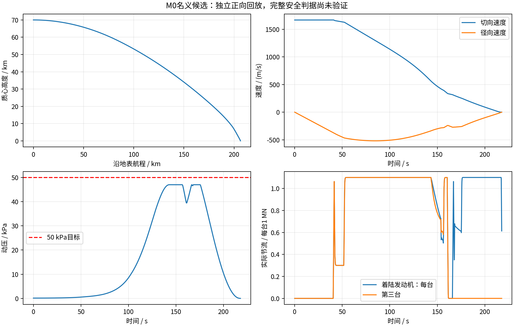

# A题v8：受约束低消耗候选

已找到**M0名义可计算约束子集通过**的候选。**完整v4安全判据尚未全部验证；不是全局最小燃料证明。**

[报告Word](reports/2026_UPC_A题_受约束低消耗候选.docx) · [PDF](reports/2026_UPC_A题_受约束低消耗候选.pdf) · [在线报告](reports/受约束低消耗候选.md) · [完整代码资料包](downloads/UPC_2026_A_v8_受约束低消耗候选.zip)

| 指标 | 独立正向回放 |
|---|---:|
| 初始携带总推进剂（液氧+甲烷） | 149.300 t |
| 实际消耗 | 147.842 t |
| 可用剩余 | 711.107 kg（门槛701.055 kg） |
| 接触参考点速率 | 0.999936 m/s |
| 最大动压 | 47.008 kPa（≤50） |
| 最大力幅值预算 | 2.5275（≤4） |
| 飞行时间 | 217.746 s |
| 名义船位地表航程 | 206.350 km |

策略：先滑行40 s→三台再入燃烧→160.416 s关机指令→165.416 s两台再点火指令→两台完成末段。具体节流与推力方向必须使用[控制节点](results/data/controls_N320.npz)，仅有时刻表不能复现。固定0/20/40/50 s点火比较中40 s较低耗；连续点火时刻搜索未收敛，60 s试验未得解，均不能证明全局不可行或最优。

较立即点火320区间候选的150.862 t，初始携带量减少约1.562 t（1.04%）；这只是在当前策略族、假设与数值搜索范围内的比较。v7固定70 t的失败不等于所有70 t方案均不可能。

模型保留变质量、中心重力、分层大气和恒Cd阻力，含点火延迟、节流响应、速率与重启。q与气动力载荷同一时刻耦合。参考接触是CG高度32.5 m，CG速度不能冒充脚端速度；推力方向不能冒充箭体姿态。尚缺姿态/万向节权限、包络/脚端/甲板、热结构与接触后稳定性，因此**目前没有证明全套安全约束通过**。

验证：独立SI Cartesian DOP853回放；160/320网格与0.1/0.05 s最大步长对比通过，符号/独立大气层表一致。见[verification.json](results/data/verification.json)、[逐条约束状态](results/data/constraint_assessment.csv)、[轨迹CSV](results/data/candidate_trajectory.csv)、[代码重跑说明](simulation/README.md)。原型错误大气与未收敛结果不作为候选。

影响基线：5e0f8190a8815079a73aa0d617ecfc3b689ae9d8。仅新增火箭v8模型、求解、数据与报告/索引；v1–v7和B题计算文件不改；原理图/管脚/器件值、器件/BOM/封装、PCB、固件及旧电子工程模型不变。
