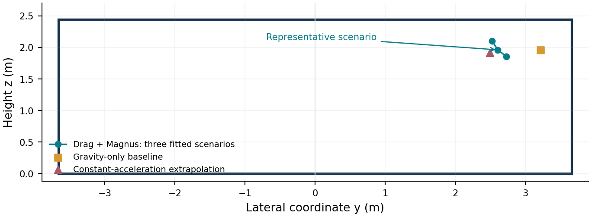

# 2026 UPC B题：点球轨迹预测：基本建模思路

用途：团队讨论、建模分工与论文框架制定    |    日期：2026年11月7日

核心路线：三维动力学 → 早期观测反演 → 合理参数集合／分布 → 球门交点与不确定性。

## 1 题目到底要求什么

已知球心在起脚时及之后两个时刻的位置，预测足球第一次向前穿过 x = 11 m 平面时的横向坐标 y 和高度 z，并估计预测的不确定性。研究对象是早期信息支持的落点预测；模型要同时回答“在哪里”和“有多可靠”。

| 时间 t / s | 球心位置 (x, y, z) / m |
| --- | --- |
| 0 | (0, 0, 0.11) |
| 0.05 | (1.50, 0.45, 0.44) |
| 0.10 | (2.96, 0.86, 0.74) |

球门范围：−3.66 < y < 3.66 m，0 < z < 2.44 m。主模型先按题目给出的球心交点分析；若考虑球半径与门柱碰撞，应单独增加几何判据。

### 2 三个必须抓住的问题

- 观测窗口只有 0.10 s，样例约到 0.40 s 才到球门，早期的小误差会在外推过程中放大。

- 两次三维观测提供 6 个标量信息；若同时估计初速度、阻力和任意方向自旋，参数通常不能唯一确定。

- 题目没有给测量误差分布或自旋先验。可以在明确假设下给预测区域，不能凭空给出唯一的 95%区间。

### 3 最终应交付的结果

① 到达球门平面的时间；② 最可能的交点；③ 二维预测区域或合理范围；④ 交点位于球门内的概率（采用概率模型时）；⑤ 不同噪声、气动和自旋假设下的稳定性。

本文件定位：基本思路与已核算的代表性算例。完整概率采样、覆盖率验证及外部数据验证仍需实施。

## 4 模型怎么搭：先基准，再物理主模型

| 层级 | 形式与作用 |
| --- | --- |
| 基准一：重力抛体 | 固定初始位置，最小二乘拟合初速度；用于量级检查和程序自检。 |
| 基准二：恒加速度 | 三点拟合二次轨迹；用于提取早期速度、加速度，不直接作为可靠的全程预测。 |
| 主模型：阻力＋马格努斯力 | 描述气动减速和侧向弯曲；通过位置观测反演参数，并传播不确定性。 |

### 4.1 先用数据说明为何需要侧向作用

无风且只有重力、速度反向阻力时，足球的水平运动方向不变，从原点出发应保持 y/x 不变。样例却给出 0.45/1.50 = 0.300，与 0.86/2.96 ≈ 0.2905。若将坐标当作精确值，简单模型无法同时吻合；可能原因包括自旋、风、其他侧向气动力或观测误差。

### 4.2 推荐的有效参数模型

dr/dt = v，    u = v − w

dv/dt = −g e_z − κ |u|u + Ω × u

式中 r、v、u、w、Ω 为三维向量，e_z 为竖直向上单位向量。主模型先设无风 w = 0；g = 9.81 m/s²。

| 参数 | 物理意义与限制 |
| --- | --- |
| κ，单位 m⁻¹ | 有效阻力参数：κ = ρ C_D A / (2m)，应为正值。 |
| Ω，单位 s⁻¹ | 有效旋转向量，表示马格努斯作用；它不是直接测得的真实自旋角速度。 |
| 常系数近似 | 假设短暂飞行中 κ 和 Ω 近似不变；用变化气动系数的模型检查近似误差。 |

### 4.3 控制模型范围

- 足球先视作质点；质量、尺寸和空气状态由题目外资料或明确的基准假设补充。

- 主模型适用于入门前未触地的空中飞行。先触地时，应增加反弹分支或标记超出适用范围。

- 阻力与自旋气动系数应追溯实验文献；风、自旋衰减和变系数模型用于扩展与敏感性分析。[3–6]

## 5 参数怎么反推，不确定性怎么给

### 5.1 先承认信息不足，再增加有依据的约束

无风主模型未知量为 θ = (v₀x, v₀y, v₀z, κ, Ωx, Ωy, Ωz)，共 7 个；观测只有 6 个标量。不能把某次优化得到的参数当成唯一真值。平行于瞬时速度的旋转分量不产生瞬时马格努斯力，在短观测窗口中尤其难以确定。

代表性计算可以补充 Ω·v̂_m = 0（有效旋转向量沿早期飞行方向的分量为零）。正式分析则应允许其他合理取值，展示预测如何改变；该补充条件属于假设。

### 5.2 由早期数据构造优化初值

v_m ≈ (r₂ − r₀)/(2h)，    a_m ≈ (r₂ − 2r₁ + r₀)/h²

取 h = 0.05 s，样例得到 v_m ≈ (29.6, 8.6, 6.3) m/s，a_m ≈ (−16, −16, −12) m/s²。利用气动力沿速度与垂直速度的分解，可初始化阻力和有效旋转参数。差分仅用于初始化；最终通过积分轨迹拟合位置。

### 5.3 两种可完成的求解方式

| 方案 | 操作与输出 |
| --- | --- |
| 基本版：约束拟合＋情景扫描 | 多初值拟合；扫描难以确定的参数和观测误差情景；保留满足误差容限的解，形成交点可行范围。 |
| 增强版：概率反演 | 设定观测误差模型和有来源的参数先验；构造后验并采样；将后验样本传播成交点预测分布。 |

概率形式：p(θ|D) ∝ p(D|θ)p(θ)。先验约束阻力为正、速度和有效旋转强度处于合理范围。观测误差水平未知时，分别报告多档假设下的结果，并检查先验敏感性。

### 5.4 将每组参数传播到球门

积分至事件 x − 11 = 0，记录到达时间和 (Y, Z)。保留射偏、射高等样本，用于计算进门概率；以进门为条件的位置分布应另行标注。对概率样本进行二维密度估计，直接寻找交点分布的众数，并给出预测区域。

扫描所得范围不自动等于概率区间；最大后验参数对应的交点，也不一定是交点分布中最可能的位置。

## 6 样例结果：可直接用于方案讨论

在无风、常 κ、常 Ω，且 Ω·v̂_m = 0 的补充假设下，积分拟合得到一组代表性参数：

v₀ ≈ (30.415, 9.417, 6.907) m/s，    κ ≈ 0.020071 m⁻¹

Ω ≈ (0.08283, −0.03638, −0.33951) s⁻¹

代表性结果：约 0.401 s 到达球门平面，球心交点约为 (11, 2.60, 1.96) m。

| 方法 | 时间 / s | 横向 Y / m | 高度 Z / m |
| --- | --- | --- | --- |
| 重力抛体最小二乘 | 0.371 | 3.22 | 1.96 |
| 三点恒加速度外推 | 0.405 | 2.49 | 1.92 |
| 阻力＋马格努斯力，补充上述假设 | 0.401 | 2.60 | 1.96 |

多解演示：改变 λ = Ω·v̂_m 并重新拟合其他参数，仍可吻合两次观测。λ = −2、0、+2 s⁻¹ 时，预测 (Y, Z) 分别约为 (2.52, 2.10)、(2.60, 1.96)、(2.73, 1.85) m。

图：不同模型／参数情景的球门平面交点。连线只连接展示情景，不表示概率轮廓或置信带。

这些 λ 取值用于说明信息不足带来的多解性，不是已经验证的实际旋转范围，也不是 95%区间。以上代表点不是题目数据唯一决定的答案。

已做检查：无气动力时与抛体解析解一致；代表性算例在收紧积分容差、减小最大步长后结果稳定。尚未完成概率校准和实验数据验证。

## 7 如何验证，并形成论文

| 验证层级 | 必须完成的内容 |
| --- | --- |
| 程序与数值 | 关闭气动力，对比抛体解析解；收紧容差与减小步长；用事件函数定位球门交点。 |
| 预测性能 | 生成多组轨迹，只提供前两次带噪位置；统计真实交点与预测点的距离误差。 |
| 不确定性校准 | 检查声称的 95%区域是否覆盖约 95%真实交点，同时报告区域大小。 |
| 物理稳健性 | 用变气动系数或风扰动生成测试轨迹；条件允许时用外部实测轨迹检验。 |

只用同一个模型生成并反演数据，主要检验算法；检查物理假设还需要模型失配实验或外部数据。观测误差、参数先验和模型形式的影响应分开说明。

### 7.1 推荐的实施顺序与图表

先完成：轨迹积分 → 两个基准模型 → 约束拟合与多解展示 → 误差情景扫描 → 验证。时间充足再增加概率采样、二维预测区域及覆盖率校准。

核心图表：① 三维轨迹及早期观测段；② 球门正视图上的交点分布；③ 观测误差与落点误差的关系；④ 预测区域覆盖率和面积。

### 7.2 论文框架

问题解释与数据诊断 → 假设和动力学 → 参数辨识方法 → 预测与不确定性 → 样例结果 → 验证与敏感性 → 局限及结论。主要贡献可落在“稀疏观测下可预测到什么程度”，并用数值证据支持。

### 8 参考入口（点击可打开）

[[1] UPC 2026 官方题目：Problem B](https://university-physics-competition.com/2026-competition)

[[2] UPC 2022 官方题目与金奖名单](https://www.uphysicsc.com/2022contest.html)

[[3] 2022 B · Team 358 · The Best Strategy for Penalty Kicks（重点：3.1节）](https://www.uphysicsc.com/2022-GM-B-358.pdf)

[[4] 2022 B · Team 480 · 点球初速度与自旋分析（重点：4.1节）](https://www.uphysicsc.com/2022-GM-B-480.pdf)

[[5] 2022 B · Team 471 · Analysis of Shooting Strategy in Penalty Kick](https://www.uphysicsc.com/2022-GM-B-471.pdf)

[[6] Kray et al. (2014), Magnus effect on a rotating soccer ball… DOI: 10.1016/j.jweia.2013.10.010](https://doi.org/10.1016/j.jweia.2013.10.010)

借鉴关系：往届论文支持足球正向动力学和求解框架；本方案的观测反演、交点分布与覆盖率检验，需要另行实现和验证。
