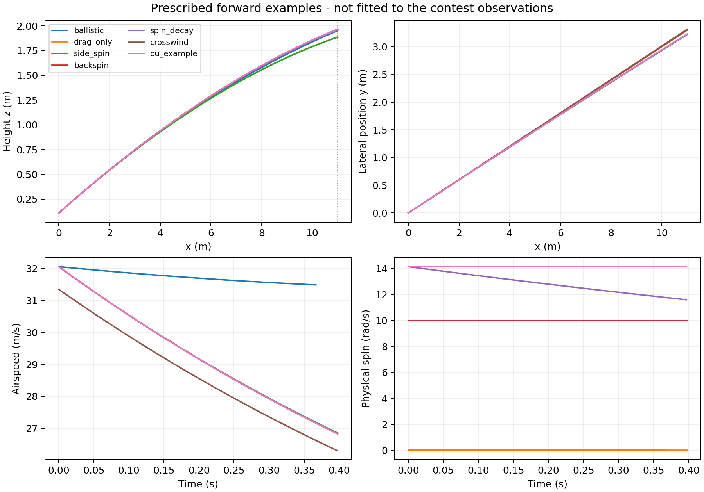

# 2026 UPC B题：物理主动力模型

正向计算实现与使用说明 · v3 · 2026年11月7日

> 本次实现：给定初始状态和参数，计算三维飞行轨迹。未进行参数反推、观测同化、后验估计或进门概率计算。

### 1 输入与输出

| 输入 | 含义与单位 |
| --- | --- |
| 初始状态 | 球心位置 r₀（m）、速度 v₀（m/s）、真实自旋 ω₀（rad/s）。 |
| 球与环境 | 质量、半径、空气密度、动力黏度、重力和恒定风速。 |
| 气动闭合 | 常数/查表阻力；线性/饱和自旋升力；可选自旋衰减和浮力。 |
| 可选扰动 | OU相关时间、潜在加速度协方差、初始残差和随机种子。 |

输出时间序列包括位置、速度、自旋、重力/浮力/阻力/马格努斯力/侧向残差、雷诺数及气动系数；同时记录首次穿门、触地或达到时间上限的终止状态。

### 2 模型结构与范围

确定性核心采用三维平动＋三维自旋向量，共9个状态；OU潜在加速度由单独的已保存路径驱动。未加入球缝姿态角，因此不把它称为完整姿态耦合的6-DOF模型。

- 已实现：重力、浮力、相对风阻力、一致定义的自旋升力、自旋衰减及事件定位。

- 可选实现：可替换阻力表、饱和升力律、指定随机种子的OU横向气动残差。

- 未实现：球缝取向、球体变形、反弹/滚动、纵向随机阻力、参数估计与概率校准。

基准设置 m = 0.43 kg，R = 0.11 m，ρ = 1.225 kg/m³，μ = 1.8×10⁻⁵ Pa·s，g = 9.81 m/s²。质量处于IFAB规则范围，其余环境和气动设置均需按实际条件确认。

## 3 主动力方程与符号

u = v − w，    U = |u|，    A = πR²，    V = 4πR³/3

dr/dt = v

m dv/dt = (m − ρV)g + F_D + F_M + m P⊥(u)b

dω/dt = −λ_spin ω

g = (0,0,−g)。关闭浮力时，重力预算中的 (m−ρV) 改为 m。风场 w 在单次模拟中为空间均匀、时间恒定。若不使用OU残差，则 b = 0。

### 3.1 阻力

F_D = −½ρ A C_D(Re) U u，    Re = 2ρRU/μ

C_D 非负，可设常数或输入递增Re表格并线性插值。表域外采用端点值，并在结果中明确标记；这只是受控的数值处理，不是得到验证的外推。不能由本题雷诺数直接认定未知球型必处于阻力危机区。

### 3.2 马格努斯力及横向自旋参数

S_perp = R |ω × u| / U²

F_M = ½ρ A U² C_L(S_perp) (ω × u)/|ω × u|

仅在 U>0 且叉积非零时计算上述方向；零相对速度、零自旋或平行自旋的马格努斯力定义为零。S_perp 使用垂直于气流的自旋分量，避免任意旋转轴引入额外的正弦因子。

### 3.3 侧向残差

P⊥(u) = I − ûûᵀ，    û = u/U

残差力为 mP⊥b，因此与相对速度正交。零相对速度时所有空气动力均定义为零。该约束只刻画横向残差；并不表示模型包含所有湍流作用，也不意味着含风系统在地面系中的机械能必然单调下降。

## 4 系数闭合与自旋：统一速度因子

### 4.1 默认线性自旋升力律

C_L = c_s S_perp

代入第3节的升力公式，可严格化简为：

a_M = F_M/m = [ρ A c_s R/(2m)] (ω × u)

> 若 c_s 不变，有效旋转向量 Ω = [ρ A c_s R/(2m)]ω。此时不能再额外乘 U/U₀；真实自旋衰减时，Ω随ω衰减。

真实自旋 ω 与v1中的有效旋转参数 Ω 不同。只有明确给出气动系数和球/空气参数后，才能进行换算。本版本只读取人为指定的 ω，不从观测反推它。

### 4.2 可选饱和闭合

C_L = C_L,max tanh(c_s S_perp / C_L,max)

该形式在小自旋参数下接近线性，并限制升力系数幅值。它是可替换的经验近似，尚未用特定足球的实验数据标定；不能自动视为精度更高。

### 4.3 自旋衰减和阻尼力矩

ω(t) = ω₀ exp(−λ_spin t)，    I_shell = (2/3)mR²

M_spin = −I_shell λ_spin ω

λ_spin 由输入给定，可设为零；采用各向同性薄球壳惯量输出等效阻尼力矩，不使用实心球的2/5惯量。没有将马格努斯横向力直接当成阻碍自旋的力矩，也没有额外拟合转动力学。

### 4.4 参数状态

示例中的 C_D = 0.25、c_s = 0.6、λ_spin = 0或0.5 s⁻¹均为演示设置；不称为真实比赛足球已知参数。黏性历史力、附加质量、攻角稳定导数等未直接套入本题高雷诺数模型。

## 5 可选OU驱动、数值求解与事件

db = −(b/τc)dt + √(2/τc)L dWₜ，    LLᵀ = Σb

b 的单位为m/s²，Σb的单位为(m/s²)²，可为一般半正定协方差矩阵。τc为相关时间。指定b₀时按该初态演化；b₀=null时抽取稳态初值。它不是位置测量噪声。

bₖ₊₁ = α bₖ + √(1−α²)Lξₖ，    α = exp(−Δt/τc)

OU节点采用精确高斯转移，节点之间线性插值；位置、速度和自旋使用DOP853积分。节点精确不等于耦合系统精确；已用同一组细网格节点检查网格细化。有限相关时间下，残差通过普通dt项进入速度方程，未替换为直接速度白噪声。

### 5.1 三种终止状态

| 状态 | 判据与解释 |
| --- | --- |
| goal_plane | 第一次向前穿过x=11；用事件根定位，输出球心坐标和矩形内外判断。 |
| ground_contact | 球心下降至z=R即终止；不模拟反弹或滚动，不能据此直接断言最终未进门。 |
| time_limit | 达到设定时间上限；未发生前两个事件。 |

球心在门框平面内的几何余量只作为诊断，不等于圆柱门柱碰撞，也不等于整球越线判定。禁止对终止时刻以后的时间取样外推。

### 5.2 可复算与接口

输入JSON保存共同参数与工况覆盖项，结果JSON保存每个工况的完整展开输入；CSV保存轨迹和各力分量。OU路径单独保存节点和种子。相同输入可复算，不意味着该输入已经由实测确认。

核心函数：PhysicsModel.forces、PhysicsModel.derivative、simulate、Trajectory.sample_at；参数数据类负责检查非有限值、负系数、不合法气动表及OU协方差。

## 6 手工参数的正向演示结果

共同初速度设为 (30,9,6.82) m/s，初始位置为 (0,0,0.11) m。下面的初速度、自旋、风和气动系数均为手工输入，未使用题目两次位置观测做拟合。

| 工况 | 时间 / s | Y / m | Z / m |
| --- | --- | --- | --- |
| 抛体（关闭浮力） | 0.366667 | 3.3000 | 1.9512 |
| 阻力＋浮力 | 0.397206 | 3.3000 | 1.8875 |
| 侧旋 | 0.396334 | 3.2175 | 1.8855 |
| 后旋 | 0.397761 | 3.3043 | 1.9649 |
| 混合自旋＋衰减 | 0.396907 | 3.2265 | 1.9580 |
| 横风 | 0.396459 | 3.3133 | 1.9652 |
| 一条OU示例路径 | 0.396941 | 3.2259 | 1.9641 |



图：规定输入下的轨迹、相对气流速度和真实自旋。曲线差异说明模型作用，不表示这些输入都能吻合题目观测；单条OU轨迹不是预测分布。

## 7 已执行验证、运行与资料来源

已执行15项解析/数值检查，全部通过。检查日志保存完整指标；这些检查支持程序与方程的一致性，不代表真实足球的物理参数已被标定。

| 检查组 | 验证内容 |
| --- | --- |
| 解析极限 | 无气动力抛体、浮力修正的有效重力、自旋指数衰减。 |
| 力学性质 | Magnus线性化简、横向正交性、阻力耗散、相对风一致性、反射对称。 |
| 事件与输入 | 穿门/触地/时间上限、零流速与零自旋、不合法参数与查表边界。 |
| 数值与随机驱动 | 确定性步长、OU协方差和相关性、同节点耦合网格细化。 |

### 7.1 运行命令（在simulation目录）

```bash
python -m pip install -r requirements.txt
python verify_physics.py
python run_forward.py
```

修改configs/forward_examples.json即可替换已知输入；代码不包含参数反演器，也未计算后验或95%预测区域。

### 7.2 来源与适用边界

[2026 UPC题目](https://university-physics-competition.com/2026-competition)

[IFAB Law 2：比赛用球质量范围](https://www.theifab.com/laws/latest/the-ball/)

[Kray et al. (2014)：旋转足球气动力实验](https://doi.org/10.1016/j.jweia.2013.10.010)

[Asai & Hong (2021)：球型、朝向与风洞气动系数](https://pmc.ncbi.nlm.nih.gov/articles/PMC8100144/)

[Mizota et al. (2013)：低自旋非定常侧向力](https://pmc.ncbi.nlm.nih.gov/articles/PMC3660809/)

文献支持气动建模动机，不直接校准当前闭合参数和OU统计量。本版未导入实验气动表，尚未完成实测轨迹验证。

变更基线为c30f693：新增独立v3足球正演代码和文档；v1/v2保留，现有电子工程原理图、器件/BOM、PCB、固件及其仿真模型均未修改。
